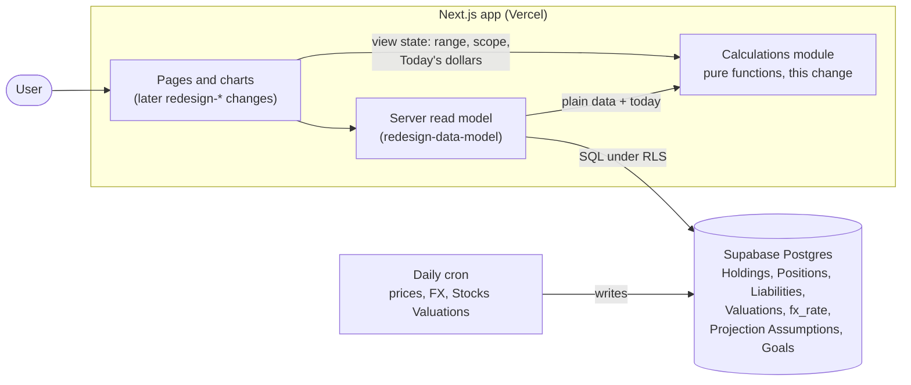
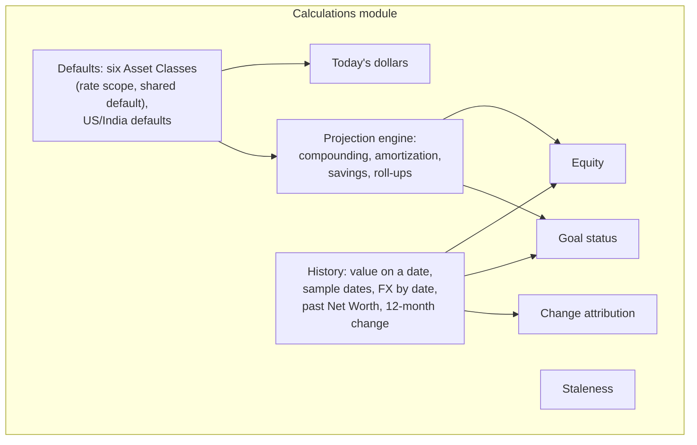

# Design

## Context

See proposal.md (Why) for motivation. The decisions come from the closed wayfinder map [#13](https://github.com/adarsh645-git/finasset-360/issues/13) and its tickets. The formulas follow the mockup handoff's Calculations section and `model()`/`attr()`/`goalInfo()` in `Portfolio Tracker.dc.html` (on the `docs/mockup-handoff` branch).

The current code has a yearly, single-rate engine (`src/lib/projection/engine.ts`), a step-function timeline built on `fx_rate_to_home` (`src/lib/net-worth/timeline.ts`), and a staleness helper (`src/lib/valuations/staleness.ts`). All of it is typed against the old schema's `components/portfolio/types`, and live routes and pages still use it. `redesign-data-model` deletes it. Until then, the new functions must sit beside it without touching it.

Governing ADRs: 0006 (fixed Asset Classes), 0007 (Liabilities are amortizing loans), 0008 (dated Valuations, FX by date) and 0009 (monthly Projection, per Country and Asset Class).

## Goals / Non-Goals

**Goals:**
- One calculations module that every later `redesign-*` change reads its numbers from. Pages and the read model only map data into it and format what comes out.
- Every scenario in `specs/` proven by a unit test at that module's public functions.

**Non-Goals:**
- Reading from Supabase, the clock or the network. Callers pass in "today", the FX Rate table and the data.
- Copy and formatting ("in 3 yrs", "· 47 days old", "Reached Mar 2025"), which belong to each page change.
- Replacing or editing the old helpers.

## Architecture

The module is a component inside the one Next.js container. Its whole job is to turn plain data into plain numbers, so the diagram shows where that data comes from and who will call it.

- **Boundary:** nothing in the module performs I/O or reads the clock. "Today" is an ISO date argument.
- **Data flow:** the read model (built in `redesign-data-model`) loads rows under RLS and maps them into the module's own input types. Pages add view state (range, Country scope, Today's dollars) and call the module directly.
- **Goal status** joins the two halves: recorded history up to today, then the Projection.
- **Assumption:** the read model doesn't exist yet. Until it does, only the tests call the module.

## Decisions

### D1. One new module beside the old code, with its own input types
A new `src/lib/calc/` module defines its own plain types (Holding, Liability, Valuation, FX Rate, Projection Assumptions inputs) in CONTEXT.md vocabulary. It imports nothing from `components/portfolio/types` and edits no old file.
- *Alternatives:* rewrite `src/lib/projection/engine.ts` in place, rejected because live routes still depend on it until the cutover. Fold the module into `redesign-data-model`, rejected because the sequence keeps that change reviewable ([#16](https://github.com/adarsh645-git/finasset-360/issues/16)).

### D2. A monthly engine, rewritten rather than extended
One pure function takes Holdings (Country, Asset Class, native current value), Liabilities (Country, balance, APR, Monthly payment), Projection Assumptions with blanks, today's FX Rate, the horizon and today. It returns monthly series 0..horizon×12 (see `projection` spec) and, per Liability, the payoff month, interest remaining and Not on track flag. Holdings and Liabilities are projected separately, then netted. ([#5](https://github.com/adarsh645-git/finasset-360/issues/5))
- *Alternative:* extend the yearly segmented closed form. Rejected: per-Country × class rates, monthly amortization and monthly savings make the segments unmanageable, and the mockup is monthly.

### D3. Holdings compound as v × (1+r)^(k/12)
This is effective-annual compounding, as in the mockup. The savings pool uses the same monthly factor (1+r)^(1/12).
- *Alternative:* a nominal r/12 monthly rate. Rejected because it disagrees with the mockup's numbers.

### D4. Amortization, Not on track and the 720-month limit
Each month, b = max(0, b(1 + APR/12) − payment). Today's balance is the recorded one, never amortized forward to today. Payoff is the first month b = 0, and the simulation continues past the horizon to find it. A Liability is Not on track when payment ≤ b × APR/12, or when it doesn't pay off within 720 months (the mockup's search limit). In that case it has no payoff month and no interest remaining. ([#3](https://github.com/adarsh645-git/finasset-360/issues/3), [#4](https://github.com/adarsh645-git/finasset-360/issues/4))
- *Alternatives:* hold a Not on track balance flat (rejected: it hides the problem, and the mockup lets it grow); report partial interest for Not on track loans (rejected: the number would be meaningless).

### D5. Monthly savings: end of month, yearly steps, freed payments flat
- **Timing:** from month 1, each Country's amount is added at month end into a pool compounding at that Country's Stocks rate.
- **Yearly step:** for months 12y+1 … 12y+12 the amount is base × (1+g)^y.
- **Freed payments:** from the month after a Liability's payoff, its Monthly payment is added at a flat amount.
- **Where it counts:** the pool counts in its Country's assets, the Stocks class, total assets and Net Worth, never in a Holding.

([#19](https://github.com/adarsh645-git/finasset-360/issues/19). The flat freed payment was settled with the user while proposing; CONTEXT.md is updated.)
- *Alternatives:* escalate freed payments too (rejected by the user); savings at the start of the month (rejected: end of month is the convention the annuity check uses, and the difference is negligible).

### D6. Defaults are code constants; blank means default
The six Asset Classes (id, name, rate scope, shared default) and the US/India defaults (inflation, Real estate, Stocks, Cash) are constants in the module, and blank inputs resolve against them. A blank savings amount or savings growth rate resolves to 0, and a blank horizon to 10. ([#2](https://github.com/adarsh645-git/finasset-360/issues/2), [#5](https://github.com/adarsh645-git/finasset-360/issues/5))
- *Alternative:* seed stored rows with defaults. Rejected: "Reset defaults" would then have to rewrite rows. If `redesign-data-model` moves Country defaults into a table, it passes them in instead, and the resolution rule stays the same.

### D7. One history rule, with the current value as today's Valuation
The value on date d is a straight line by day between the Valuations either side, flat after the last, 0 before the first, and 0 after the archive date. The caller passes the current value, which acts as a Valuation dated today; for Stocks it is computed live and may differ from the last cron snapshot. Samples are the start, month-ends and today, and the start is clamped to the earliest Valuation. ([#4](https://github.com/adarsh645-git/finasset-360/issues/4), [#16](https://github.com/adarsh645-git/finasset-360/issues/16) empty states)
- *Alternatives:* a step function, the old timeline (rejected: [#4](https://github.com/adarsh645-git/finasset-360/issues/4) chose interpolation); holding flat from the last Valuation to today for Stocks (rejected: the chart's today point would disagree with the headline).

### D8. FX by date: the latest rate on or before, else the earliest
The lookup returns the rate and its as-of date. A date before the table starts uses the earliest rate; the one-time backfill should make that case rare. ([#4](https://github.com/adarsh645-git/finasset-360/issues/4))
- *Alternative:* fail or return nothing. Rejected: a gap in the table would blank the whole chart.

### D9. 12-month change: absent for a new item, like-for-like for a set
An item with no Valuation on or before the start has no change. That gives "—" instead of +100% ([#16](https://github.com/adarsh645-git/finasset-360/issues/16)). A set (an Asset Class, all Liabilities) sums only the items that existed at the start.
- *Alternative:* a naive total difference, as the mockup does. Rejected: adding an account would show as class growth, and a new loan would make "paid down" negative.
- This supersedes [#3](https://github.com/adarsh645-git/finasset-360/issues/3)'s "a new loan shows paid down = 0": the item shows "—", and a set with only new loans has no figure. Net Worth's own change over a range stays a plain difference, matching attribution (D11).

### D10. Today's dollars counts whole calendar months
v ÷ (1 + inflation)^(k/12), with k the whole calendar months from the current month (negative for the past). Each Country uses its own resolved inflation, and the results are then summed. ([#5](https://github.com/adarsh645-git/finasset-360/issues/5), ADR 0009)
- *Alternative:* day-exact offsets. Rejected: samples sit at month-ends, and whole months keep today's point exactly unchanged.

### D11. Change attribution uses the mockup's three terms
For t0 and a Country scope, this is the mockup's `attr()`: native at t0 comes from D7 (0 for items added later, 0 after archive), native now is the current value, FX at t0 comes from D8, and FX now is today's rate. The terms reconcile exactly. ([#4](https://github.com/adarsh645-git/finasset-360/issues/4))
- *Alternative:* splitting savings out of "asset growth". Rejected: history can't tell savings from growth, so the mockup's label "asset growth & savings" stays a UI concern.

### D12. Equity, % owned and Equity built
Pointwise over any pair of USD series or numbers. % owned is clamped to 0–1, and a value of 0 gives 0. ([#2](https://github.com/adarsh645-git/finasset-360/issues/2))

### D13. Goal status returns data, not copy
The input is one nominal USD Net Worth series with today's index, the target and the horizon. The output is `reached | projected | beyond`, with the month, months from today and progress. The caller always passes the all-Countries nominal series, whatever the view state. ([#6](https://github.com/adarsh645-git/finasset-360/issues/6))
- *Alternative:* return the label string. Rejected: copy belongs to `redesign-goals`, and the mockup's "in N yrs" rounding is a display choice.

### D14. Staleness: one 30-day constant, user-entered dates only
The age is in whole calendar days in UTC, and an item is Stale when the age is over 30. Callers choose the date to pass: the latest Valuation for a manually valued Holding or a Liability, or the oldest Hand Price date for a Stocks Holding. A Stocks Holding with no Hand Price passes nothing and is never Stale. ([#8](https://github.com/adarsh645-git/finasset-360/issues/8))
- *Alternative:* per-class thresholds, rejected in #8.

## Testing Decisions

**Seam (confirmed with the user):** one seam, the calculations module's exported functions, called with plain data and an injected today. There is no mocking, no snapshots of the code's own output, and no assertions on internals.

**Oracles** are independent of the implementation:
- closed forms: compounding, the annuity payoff month, the annuity future value of savings;
- identities: attribution terms sum to the Net Worth change, and roll-ups reconcile at every month;
- hand-computed examples from the scenarios.

Tolerance is `toBeCloseTo` to the cent, unless a scenario states otherwise.

| Scenarios | Test file (Vitest, `tests/unit/`) | Seam |
|---|---|---|
| PR-01 … PR-21 | `calc-projection.test.ts` | Projection engine + defaults |
| NH-01 … NH-17 | `calc-net-worth-history.test.ts` | History, FX lookup, 12-month change, Today's dollars, attribution |
| EQ-01 … EQ-06 | `calc-equity.test.ts` | Equity |
| GS-01 … GS-05 | `calc-goal-status.test.ts` | Goal status |
| ST-01 … ST-05 | `calc-staleness.test.ts` | Staleness |

Each test name starts with its scenario ID (docs/agents/issue-tracker.md), and `npm run spec:coverage` gates them. No scenario needs a browser, and there are no Playwright or route tests.

**Prior art:** `tests/unit/projection-engine.test.ts` (an engine checked against closed forms), `net-worth-timeline.test.ts` and `staleness.test.ts`. Their style carries over, but not their types.

## Risks / Trade-offs

- [Two engines coexist until `redesign-data-model`] → The new module has a distinct path and imports nothing old, and the cutover change deletes the old one. No page calls the new module before then.
- [Float drift over 480 months] → Tests compare against closed forms with explicit tolerances, never exact equality on long series.
- [The FX table doesn't reach back to the first Valuation] → The earliest-rate fallback (D8). The backfill in `redesign-data-model` is meant to cover the full history.
- [The read model maps rows wrongly, e.g. passes a cron date for staleness] → The module's inputs name which date they want ("user-entered date"), and `redesign-data-model`'s route tests own the mapping.
- [Performance] → 481 months × a few dozen items × a handful of series is trivial. Nothing is cached in this change.

## Migration Plan

Additive only: no deploy steps and no data. Rollback means reverting the commit. The old helpers are removed in `redesign-data-model`.
