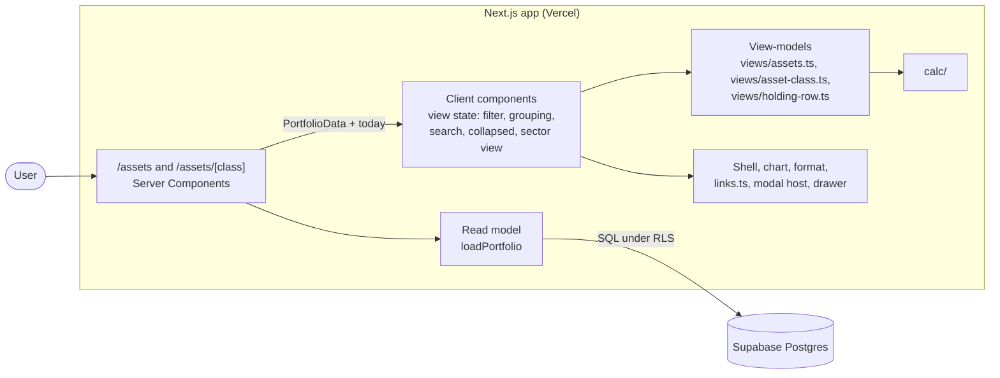

# Design

## Context

See proposal.md (Why). The decisions come from the closed wayfinder map [#13](https://github.com/adarsh645-git/finasset-360/issues/13), chiefly [#1](https://github.com/adarsh645-git/finasset-360/issues/1) (property type, city, Sector), [#2](https://github.com/adarsh645-git/finasset-360/issues/2) (fixed classes and nouns), [#9](https://github.com/adarsh645-git/finasset-360/issues/9) (exchange) and [#16](https://github.com/adarsh645-git/finasset-360/issues/16) (scope, empty states, responsive). The screens follow the mockup README's screens 2 and 3 (layout A) and the prototype's `renderVals()` `as` and `cl` blocks with `layout === 'O'`.

When this change starts, the earlier changes have shipped:
- `redesign-calculations`: `src/lib/calc/` (history, set 12-month change, Projection per Asset Class, class defaults, staleness).
- `redesign-data-model`: `loadPortfolio(supabase, today) → PortfolioData` (its design.md "Read model shape"). This change reads `holdings[]` (`assetClass`, `country`, `currency`, `name`, `description`, `propertyType`, `city`, `costBasis`, `currentValue`, `archivedAt`, `valuations`, and `positions[]` with `ticker`, `shares`, `avgCost`, `price`, `priceSource`, `priceAsOf`, `name`, `sector`, `exchange`), plus `fx` and `assumptions`. A current Holding is one with `archivedAt` null.
- `redesign-shell-and-overview`: the shell, `src/lib/format/`, the chart primitive (x-axis by date; it trims projected points when the projection toggle is off), the projection toggle context, and the link registry `src/lib/views/links.ts` (`EXISTING_ROUTES`, `hrefFor`, `RowLink`).
- `redesign-holding-entry`: the modal host in the layout (`?modal=add-asset[&class=]`), `/holdings/[id]`, the position drawer (`?position=<holdingId>~<ticker>`) and the stale-cue helper.

This change adds two pages and two view-models. It writes nothing, so it needs no routes and no migration.

## Goals / Non-Goals

**Goals:**
- Every scenario in `specs/` proven against a pure view-model, or against server-rendered markup where a scenario is about links.
- One row builder shared by the Assets list and the class tables, so the two can't drift.

**Non-Goals:**
- New calculations: every number comes from `calc/` or is a sum or ratio of its outputs.
- Changing the modal, drawer or Holding detail beyond turning on their links to the new pages.

## Architecture

The two pages are Server Components inside the existing Next.js container. They load the Portfolio once and hand plain data to a client component, which keeps the list's view state and calls a pure view-model.

- **Boundary:** view-models take `(PortfolioData, viewState, today)` and return exactly what the screen shows: strings, order, which cards render, `href | null` for each link, and the empty state. They don't read the clock, cookies or the URL.
- **Interaction state** (tile filter, grouping, search, collapsed groups, sector view, open sectors) is client React state. The modal and drawer are search params, owned by holding-entry.

## Decisions

### D1. Server page, client view state, pure view-model
Each page loads `PortfolioData` on the server and passes it, with today, to a client component. That component holds the view state and calls `buildAssetsView` or `buildAssetClassView` on every change. Search is instant and needs no server round trip.
- *Alternatives:* filter, grouping and search in search params with a server re-render. Rejected: every keystroke would trigger a navigation, the mockup doesn't keep this state, and the brief keeps the URL for things Back should close (modal, drawer). Remembering view state across visits is a non-goal.

### D2. Layout A only
The class pages implement the approved layout A: the full-size chart, the Positions card with By sector | All positions, and the two Real estate cards. Filter chips, the Positions | Accounts toggle, the mini chart and the treemap aren't built. ([#16](https://github.com/adarsh645-git/finasset-360/issues/16), README "Layout A is the approved one")
- *Alternative:* build B and C behind a setting. Rejected (YAGNI): they were design explorations.

### D3. One row builder for every Holding row
`views/holding-row.ts` builds a row from a Holding: name, subtitle, Country badge, native amount (India only), USD, gain, stale cue and `hrefFor(holding(id))`. The subtitle is the Positions summary ("6 positions · AAPL, MSFT, JPM…", tickers without suffix) for Stocks, "⟨Property type⟩ · ⟨city⟩" for Real estate (just the type when there's no city), and the Description otherwise. A Stocks Holding's Cost Basis is Σ shares × `avgCost` (the read model returns `costBasis` null for Stocks). Gain is compact signed USD (INR at today's FX Rate) plus a whole percent; "—" without a Cost Basis; just the USD figure when the Cost Basis is 0. The stale cue comes from holding-entry's helper ("· 47 days old", "· prices 47 days old"). ([#1](https://github.com/adarsh645-git/finasset-360/issues/1), [#8](https://github.com/adarsh645-git/finasset-360/issues/8))
- *Alternatives:* the prototype's "Residential · " with an empty city (rejected: a dangling separator); separate builders per page (rejected: the README defines one compact row).

### D4. Grouping, collapse and search follow the prototype
- **Class grouping:** groups in the fixed class order with the class noun. **Country:** "United States" then "India", counted in items. **None:** "All holdings".
- **Shares:** group shares are always of total assets, also when filtered.
- **Collapse:** collapsed state is kept per grouping and group key. "Expand all" shows only when every group is collapsed.
- **Search:** case-insensitive substring over name, Description, city, stored tickers (`INFY.NS` matches "infy") and company names (ticker data, or the Position's own name). A non-empty query shows every group open without changing the stored collapsed state. ([#1](https://github.com/adarsh645-git/finasset-360/issues/1) Description and city, [#9](https://github.com/adarsh645-git/finasset-360/issues/9) company names)
- *Alternative:* fuzzy matching. Rejected: the mockup uses substring matching, and the lists are short.

### D5. In Country grouping the badge shows the Asset Class
In a Country group the Country badge would repeat the header, so it shows the class name ("Real estate", "Stocks"). The prototype shows the class's first word ("Real", "Vehicles"), which reads as a truncation.
- *Alternative:* keep the Country badge. Rejected: the mockup swaps it, and it would carry no information.

### D6. 12-month changes use the set rule from `calc/`
The Assets header uses the set 12-month change of all current Holdings, and a class header uses that of the class. Both count only Holdings that existed 12 months ago, and both read "—" when the change is absent ([calc D9](../redesign-calculations/design.md)). The Overview's Total assets stat and Allocation rows use the same rule, so the figures agree across pages.
- *Alternative:* the prototype's plain difference. Rejected: a new account would show up as growth.

### D7. Header counts
"⟨N⟩ accounts & assets in ⟨M⟩ classes", with "1 account or asset" and "1 class" in the singular (as the Overview's stat card does, OV-07). M counts classes with current Holdings.

### D8. Ticker display: exchange, name, Sector and price
The ticker shows without its `.NS`/`.BO` suffix. The read model already resolves each Position's `name`, `sector`, `price` (`priceSource` "market" beats "hand") and `exchange` label (XNAS → NASDAQ, XNYS → NYSE, …, `.NS` → NSE; data-model D15). An unknown ticker's name defaults to the ticker and its Sector to Other there. This change only renders those fields, and shows a null `exchange` as "—". Positions with `priceSource` "hand" carry holding-entry's "· price N days old" cue, from `priceAsOf`. ([#9](https://github.com/adarsh645-git/finasset-360/issues/9), [#12](https://github.com/adarsh645-git/finasset-360/issues/12))
- *Alternative:* "BSE" for `.BO`. Rejected: `.BO` auto-suffixing is out of scope in #12, and the prototype shows "—".

### D9. Positions card arithmetic
- **Values:** a Position's value is shares × price, in USD at today's FX Rate.
- **Weight and sector share:** both are over all Positions in the class.
- **Gain:** a Position's gain is (price − avg cost) ÷ avg cost. A sector's gain is (Σ value − Σ shares × avg cost) ÷ Σ cost, all in USD at today's FX Rate.
- **Sorting:** sectors and the Positions inside them are sorted by value, largest first. Sectors start collapsed, as in the prototype.
- **Names:** the company name gets " · ⟨Holding name⟩" only when the class has more than one Holding.
- **Phone:** the view-model returns the sector subtitle for both widths, and the phone one leads with the share.
- *Alternative:* sector gain as the mean of position gains. Rejected: it ignores position size.

### D10. Real estate cards: property type, and "Not set" for no city
By property type groups by the required Property type. By location groups by city, and an empty city groups as "Not set". The prototype falls back to the Country name, but [#1](https://github.com/adarsh645-git/finasset-360/issues/1) settled "Not set". Location colours cycle through the prototype's four neutral tones. Property type colours are fixed per type.
- *Alternative:* the Country fallback. Rejected by #1: it mixes a city with a country.

### D11. Class chart: class history, then the class Projection
The recorded part is the class's USD history from `calc/`, sampled at month-ends plus today and starting at the class's earliest Valuation. The projected part is `calc/`'s Projection series for the Asset Class over the horizon. The view-model always returns both, and the chart primitive trims the projected points when the shared toggle is off. The x-axis is by date. For Stocks, the Projection includes the Monthly savings pool, because calc counts it in the Stocks class ([calc D5](../redesign-calculations/design.md)). ([#16](https://github.com/adarsh645-git/finasset-360/issues/16), addendum)
- *Alternatives:* start two months before the first value, as the prototype does (rejected: calc D7 clamps to the earliest Valuation); a range control (rejected: the mockup has none on class pages).

### D12. Empty states
With no current Holdings, `/assets` keeps the header ("$0", with no subtitle) and replaces the tiles and card with "No accounts or assets yet" + Add. An empty class page shows "$0", "—" and "0% of assets", then "No ⟨plural noun⟩ in ⟨class⟩ yet" + Add, with no chart. A class page exists for every class even when the sidebar doesn't list it, so the URL never 404s for a real class. ([#16](https://github.com/adarsh645-git/finasset-360/issues/16) empty states)

### D13. Unknown slugs are a 404
The page checks the slug against `calc/`'s six Asset Class ids and calls `notFound()` otherwise. The view-model takes a valid id only.

### D14. Links go through the registry
Ticket 1 adds the `assets` family to `EXISTING_ROUTES`, and ticket 3 adds `assetClass(id)`. That alone turns on the Assets nav item (sidebar, tablet tabs, phone bar), the Total assets stat card, the sidebar class rows, the Allocation rows and Holding detail's breadcrumb crumbs. The nav's active rule (Assets is active on `/assets`, `/assets/*` and `/holdings/*`) and the selected class row are set in `views/shell.ts`.
- *Alternative:* hard-code hrefs on the new pages. Rejected by the addendum: the registry is the single switch, and it keeps SH-08's plain-text rule true.

### D15. Phone and tablet
- **Column drops:** below 640px, the Tailwind `sm` breakpoint hides shares, gain, weight, Sector, Country, native and the row subtitle. Tables keep every column from 640px up. Nothing measures the window.
- **Touch:** buttons and toggles are at least 40px tall on coarse pointers.
- **Checks:** these are verified by hand, not by tests. ([#16](https://github.com/adarsh645-git/finasset-360/issues/16) responsive, README "Phone tables")

## Testing Decisions

**Seam (confirmed with the user):** screen view-models: pure functions `(PortfolioData, viewState, today) → view` tested in Vitest under `tests/unit/`. Where a scenario is about markup (a link versus plain text, which cards render), the test uses a server render with `renderToStaticMarkup`. Test data is built `PortfolioData`, with no database and no mocks of `calc/`. The calculations seam is already covered by `redesign-calculations`. This change adds no routes, so seam 2 isn't touched.

A good test asserts what the User sees: strings, order, presence, link targets. It doesn't assert internal fields or CSS classes.

| Scenarios | Test file (`tests/unit/`) | Seam |
|---|---|---|
| AS-01 … AS-18 | `views-assets.test.ts` | `buildAssetsView` |
| AS-19, AS-20 | `assets-links-render.test.tsx` | `buildShell` / `buildOverview` + `renderToStaticMarkup` |
| AC-01 … AC-08, AC-10 … AC-18 | `views-asset-class.test.ts` | `buildAssetClassView` and the slug check |
| AC-09 | `asset-class-render.test.tsx` | `renderToStaticMarkup` of the class page body |
| AC-19 … AC-21 | `asset-class-links-render.test.tsx` | shell, Overview and Holding detail views + `renderToStaticMarkup` |
| AC-22 | `holding-detail-archive-target.test.ts` | Holding detail view-model: the after-archive target is `/assets/<class>` |

AC-17 asserts the row's target (`?position=<holdingId>~INFY.NS`). That the drawer opens and closes is holding-entry's PD scenarios plus the hand check.

**Hand checks** (the user's, at 2000px, 800px and 390px against the mockup's Assets and class screens): layout, column drops, sector row alignment, hover, touch targets and the chart.

**Prior art:** `tests/unit/cash-holding-form.test.tsx`, `empty-portfolio-render.test.tsx`, and the shell-and-overview view-model tests.

## Risks / Trade-offs

- [The whole `PortfolioData` is serialised to the client] → It's a personal Portfolio of tens of Holdings. If it grows, the server can pass a trimmed shape, and the view-model signature stays.
- [Stocks class Projection includes Monthly savings, so the class line can rise faster than its Holdings] → That is calc's rule, and Growth's Stocks layer shows the same thing. The rate line in the header shows only the class rate.
- [The drawer isn't mounted on the class page] → holding-entry mounts the modal host in the layout. If the drawer is mounted only on Holding detail, ticket 4 mounts it on the Stocks page too, as holding-entry's own component, not a copy.
- [The 12-month change could differ from the Overview's] → Both call the same `calc/` set rule (D6), and AS-01 and OV-09 use the same function.
- [Group-key collisions between Class and Country grouping] → Keys are prefixed with the grouping.

## Migration Plan

UI only: no schema, no data and no production `db push`. Deploy is the normal merge. Rollback means reverting the commit, which also removes the routes from the link registry so every link falls back to plain text.
