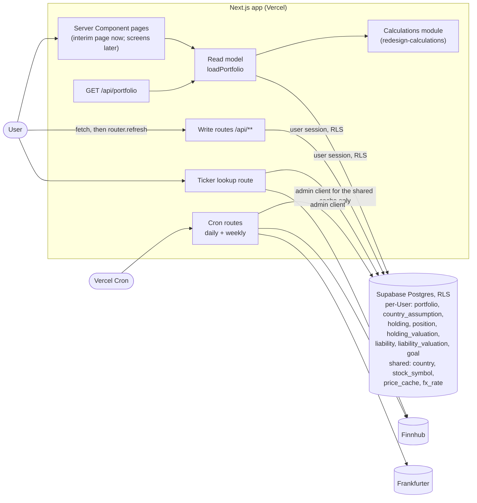

# Design

## Context

See proposal.md (Why). The decisions come from the closed wayfinder map [#13](https://github.com/adarsh645-git/finasset-360/issues/13) and its tickets, with the mockup handoff (`docs/design/portfolio-tracker/`, on the `docs/mockup-handoff` branch) as the authority over the current code and `docs/SPEC.md`.

What exists today:
- 15 migrations: `portfolio` (with `home_currency` and the `on_auth_user_created` trigger), `asset_class` and `liability_class` (global plus custom rows), `holding` (`quantity`, `price_lookup_symbol`, `sector`, `held_at`), Valuation tables with `fx_rate_to_home`, `price_cache`, `stock_symbol` (no exchange), `target_allocation`, `projection` and check-in tables.
- About 20 route handlers, the Miller shell components, and `src/lib/*` helpers typed against `components/portfolio/types`.
- Two Vercel crons: daily prices at 13:00 UTC, and the weekly symbol list on Monday at 06:00.
- Route tests under `tests/route/` that run against `supabase start`, but CI only runs `spec:coverage`.

`redesign-calculations` adds `src/lib/calc/` beside the old code. This change deletes the old code and builds the data layer under the calculations module.

Governing ADRs: 0001 (multi-tenant, RLS), 0004 (archive, don't delete), 0005 (Stocks accounts of Positions), 0006 (fixed Asset Classes), 0007 (amortizing loans), 0008 (dated Valuations, FX by date) and 0009 (Projection per Country and Asset Class).

## Goals / Non-Goals

**Goals:**
- One schema, one read model and one set of write contracts that the seven page changes only consume.
- Every rule enforced at the route boundary, with isolation enforced by the database.
- Stocks snapshots start the day this deploys.

**Non-Goals:**
- Screens beyond the interim page, formatting helpers (owned by `redesign-shell-and-overview`), and view-models.
- Reimplementing any calculation. The read model computes only Σ shares × price, which the calculations module doesn't own.

## Architecture



- **Boundary:** user data is always read and written with the User's session, so RLS does the isolation (ADR 0001). The admin (service-role) client is used only to write the shared tables and, in the daily cron, to snapshot every User's Stocks Holdings.
- **Daily cron order:** FX, then prices, then snapshots. Each step runs even if an earlier one failed, and the JSON response reports each step's outcome.

### Schema sketch

All per-User tables carry `user_id` with flat `user_id = auth.uid()` policies for select, insert, update and delete, as today. Child tables use a composite foreign key `(parent_id, user_id) → parent(id, user_id)`, so a row can't point at another User's parent (DM-03). Shared tables have a select-only policy for `authenticated`.

| Table | Columns (beyond `id`, `user_id`, `created_at`) | Constraints |
|---|---|---|
| `country` (shared) | `code` PK (`US`, `IN`), `name`, `currency`, `default_inflation`, `default_realestate`, `default_stocks`, `default_cash` | seeded in the migration |
| `portfolio` | `user_id` PK, `horizon_years`, `savings_growth`, `crypto_rate`, `metals_rate`, `other_rate`, all nullable | horizon an integer 1–40; rates −50…50 |
| `country_assumption` | PK (`user_id`, `country`), `inflation`, `realestate_rate`, `stocks_rate`, `cash_rate`, `monthly_savings`, all nullable | rates −50…50; savings ≥ 0 |
| `holding` | `country` → country, `asset_class`, `name`, `description`, `cost_basis`, `property_type`, `city`, `quantity`, `unit`, `archived_at` | class in the six ids; `property_type` not null iff realestate; `city` only realestate; `quantity`/`unit` only metals; `cost_basis` ≥ 0 and null for stocks; unique (`id`, `user_id`) |
| `position` | `holding_id`, `ticker`, `shares`, `avg_cost`, `hand_price`, `price_as_of`, `sector`, `name` | unique (`holding_id`, `ticker`); shares > 0; avg_cost > 0; `hand_price` and `price_as_of` both set or both null; sector in the 12 |
| `holding_valuation` | `holding_id`, `valued_on` date, `value` ≥ 0, `source` (`user` \| `cron`) | unique (`holding_id`, `valued_on`) |
| `liability` | `country`, `name`, `principal`, `apr`, `monthly_payment`, `term_years`, `start_month` (first of month), `revolving`, `linked_holding_id`, `archived_at` | apr ≥ 0; payment > 0; principal ≥ 0; partial unique (`linked_holding_id`) where not archived; FK `on delete set null` |
| `liability_valuation` | `liability_id`, `valued_on`, `balance` ≥ 0 | unique (`liability_id`, `valued_on`) |
| `goal` | `name` (nullable), `target_usd` | `target_usd > 0` |
| `stock_symbol` (shared) | `symbol` PK, `name`, `type`, `mic`, `sector`, `updated_at` | sector in the 12 or null |
| `price_cache` (shared) | `symbol` PK, `price`, `currency`, `fetched_at`, `last_error` | |
| `fx_rate` (shared) | `rate_date` PK, `inr_per_usd` > 0, `fetched_at` | |

`portfolio` stays the per-User anchor, auto-created by the existing trigger (DM-04), and now holds the shared settings instead of `home_currency`. Rates are stored as percent per year, as entered (7 = 7%). The read model returns them as stored, and maps them into the calculations module's fractions where it calls it.

### Route contracts

Every route uses `createRouteClient` + `requireUser`. Responses: `400 { error }` for invalid input (one plain sentence naming the field, which the UI shows in the modal footer), `404` for a record that doesn't exist or belongs to another User, `409` for writes to an archived record, and `201`/`200` with the saved record's id on success. Bodies are JSON. Amounts are numbers in native currency.

| Route | Body / query | Effect |
|---|---|---|
| `POST /api/holdings` | `asset_class`, `country`, `name`, `description?`, plus `value`, `cost_basis?`, `property_type?`, `city?`, `quantity?`, `unit?` (non-Stocks) or `positions[]` (Stocks) | creates the Holding (+ Positions) and today's Valuation |
| `PATCH /api/holdings/[id]` | the same fields, full replacement; `asset_class`/`country` must match; Stocks may add `confirm_prices: true` | updates; Stocks replaces Positions, re-dating only changed Hand Prices (all of them with `confirm_prices`); upserts today's Valuation |
| `POST /api/holdings/[id]/valuations` | `value` | Update value (non-Stocks only): upserts today's Valuation |
| `POST /api/holdings/[id]/archive` | none | sets `archived_at`; unlinks loans |
| `POST /api/liabilities` | `country`, `name`, `balance`, `principal?`, `apr`, `monthly_payment`, `term_years?`, `start_month?` (`YYYY-MM`), `revolving?`, `linked_holding_id?` | creates the Liability and today's balance Valuation |
| `PATCH /api/liabilities/[id]` | the same fields, full replacement; `country` must match | updates; upserts today's balance Valuation |
| `POST /api/liabilities/[id]/valuations` | `balance` | balance edit: upserts today's Valuation |
| `POST /api/liabilities/[id]/archive` | none | sets `archived_at` |
| `POST /api/goals` / `DELETE /api/goals/[id]` | `name?`, `target_usd` | create / real delete |
| `PATCH /api/projection-assumptions` | any of `horizon_years`, `savings_growth`, `crypto_rate`, `metals_rate`, `other_rate`, `countries: { US?: {inflation?, realestate_rate?, stocks_rate?, cash_rate?, monthly_savings?}, IN?: {…} }`; `null` = blank | partial update; upserts `country_assumption` rows |
| `GET /api/tickers/lookup?ticker=&country=` | | `{ ticker, known, name, sector, exchange, mic, price, currency }` or `{ ticker, known: false, name? , exchange }` |
| `GET /api/portfolio` | | `PortfolioData` |
| `GET /api/cron/daily`, `GET /api/cron/refresh-stock-symbols` | `Authorization: Bearer CRON_SECRET` | see `market-data` spec |

A Position in a request is `{ ticker, shares, avg_cost?, hand_price?, sector?, name? }`.

### Read model shape

`loadPortfolio(supabase, today) → PortfolioData` (in `src/lib/read-model/`), roughly:

```ts
type PortfolioData = {
  today: string;                                   // ISO date
  countries: { code: "US" | "IN"; name: string; currency: "USD" | "INR";
               defaults: { inflation: number; realestate: number; stocks: number; cash: number } }[];
  fx: { today: { rate: number; asOf: string } | null; history: { date: string; rate: number }[] };
  holdings: { id; assetClass; country; currency; name; description: string | null;
              propertyType; city; quantity; unit; costBasis: number | null; currentValue: number;
              archivedAt: string | null; createdAt: string;
              positions: { ticker; shares; avgCost; price; priceSource: "market" | "hand";
                           priceAsOf: string | null; name; sector; exchange: string | null }[];
              valuations: { date: string; value: number; source: "user" | "cron" }[] }[]; // oldest first
  liabilities: { id; country; currency; name; principal; apr; monthlyPayment; termYears;
                 startMonth; revolving; linkedHoldingId; currentBalance: number;
                 archivedAt; createdAt; valuations: { date; value; source: "user" }[] }[];
  assumptions: { horizonYears: number | null; savingsGrowth: number | null;
                 shared: { crypto; metals; other: number | null };
                 byCountry: Record<"US" | "IN", { inflation; realestate; stocks; cash; monthlySavings: number | null }> };
  goals: { id; name: string | null; targetUsd: number }[];                // target ascending
};
```

`priceAsOf` is set only for hand-priced Positions, which is what the staleness rule needs. The shared Asset Class defaults (Crypto 5, Metals 4, Other −9) stay in the calculations module, which already owns them (calc D6).

## Decisions

### D1. Start fresh: one migration drops everything and creates the new schema
No data migration and no compatibility with old tables, because production holds only test data. The old migration files stay in history, and a new migration drops the old objects (`drop table … cascade`, the old policies with them) before creating the new ones. The `on_auth_user_created` trigger and `handle_new_user` function are recreated for the new `portfolio`. ([#16](https://github.com/adarsh645-git/finasset-360/issues/16), map Notes)
- *Alternatives:* keep the Miller shell at `/legacy` (rejected in #16: 12 table renames and 115 references for test data); a separate Postgres schema (rejected: needs a manual dashboard change); squash the old migration files (rejected: production's migration history already lists them).

### D2. Country is a table; Asset Class is a check-constrained id
`country` holds US and India with currency and per-Country defaults, so a third Country is a data change (map Notes: "Country is data-driven"). The six Asset Classes are a `check` on `holding.asset_class` with the ids `realestate`, `stocks`, `cash`, `crypto`, `metals`, `other`, and a seventh is a code and migration change (ADR 0006). The read model passes the Country defaults into the calculations module (calc D6 allows this). Shared-class defaults stay in code. ([#2](https://github.com/adarsh645-git/finasset-360/issues/2), [#5](https://github.com/adarsh645-git/finasset-360/issues/5), [#17](https://github.com/adarsh645-git/finasset-360/issues/17))
- *Alternatives:* a Postgres enum (rejected: `ALTER TYPE … ADD VALUE` can't run in a transaction, and a check is easier to change); an `asset_class` lookup table (rejected: it invites the custom classes ADR 0006 removed).

### D3. Holding: one table, with class-specific columns guarded by checks
The table holds Description, Property type + city (Real estate), quantity + unit (Metals) and an optional Cost Basis (null for Stocks, whose Cost Basis is computed). `quantity`, `price_lookup_symbol`, `sector`, `held_at` and the currency column go, since the currency follows from the Country. A Property type defaults to Residential. Fields of another class are rejected rather than ignored, so a client bug surfaces. ([#1](https://github.com/adarsh645-git/finasset-360/issues/1), [#18](https://github.com/adarsh645-git/finasset-360/issues/18))
- *Alternatives:* per-class detail tables (rejected: five extra joins for three optional columns); a JSON column (rejected: no checks).

### D4. A Holding's Country and Asset Class are fixed after creation
Edit rejects a change to either. Changing the Country would re-denominate the Valuation history, and changing to or from Stocks would orphan or require Positions. (Not settled on the map: the prototype's edit form shows the chips, but it has no history to corrupt.)
- *Alternative:* allow it and keep history as is. Rejected because past values would be read in the wrong currency. Archive and re-add is the path.

### D5. Positions are replaced as a list, at most one per ticker
Stocks create and edit carry the full list. The route deletes and reinserts it in one database function call (`replace_positions`), so a failed save leaves the old list. Tickers are stored Yahoo-style, upper case, with `.NS` added for India when there's no suffix. Average cost defaults to the price on entry (market, else Hand Price). Duplicate tickers in one request are rejected; the editor already merges them. ([#1](https://github.com/adarsh645-git/finasset-360/issues/1), [#9](https://github.com/adarsh645-git/finasset-360/issues/9))
- *Alternative:* per-Position routes. Rejected because the modal saves the whole account at once, and it would add three routes to test.

### D6. Hand Price: required when there's no market price, dated on every save, beaten by market data
A Position needs a price source. If `price_cache` has the ticker, it's market-priced. Otherwise it needs `hand_price` > 0, with Sector (default Other) and name (default the ticker). Market data always wins on read, so adding a feed later needs no migration.

**Re-dating (user's decision while proposing):** a save sets `price_as_of` to today only for a new Position or one whose Hand Price changed. An unchanged Hand Price keeps its date, so renaming the account or editing another Position doesn't clear staleness. A request with `confirm_prices: true` re-dates every Hand Price on the Holding. The update pass's "Save & next" sends it, which is how confirming an unchanged price clears the Stale cue. ([#12](https://github.com/adarsh645-git/finasset-360/issues/12), [#8](https://github.com/adarsh645-git/finasset-360/issues/8))
- *Alternatives:* a shared "my prices" table (rejected in #12, YAGNI); re-date on every save (rejected by the user: an unrelated edit would hide a stale price); never re-date unchanged prices (rejected: the update pass couldn't confirm an unchanged price).

### D7. Valuations: one per item per day, upserted on every save
`holding_valuation` and `liability_valuation` are unique on (item, `valued_on`), store native amounts only, and have no `fx_rate_to_home` or home currency. Each save upserts today's row:
- Holding create and edit;
- Update value;
- Stocks edit, at Σ shares × price;
- Liability create, edit and balance edit.

This happens even when the value is unchanged. "Today" is the server's UTC date, the same as the cron's.

`holding_valuation.source` records who wrote the row: `user` for a save, `cron` for a daily Stocks snapshot. A User save on a day the cron already wrote sets `source = user`. A later cron run on that day updates only the value and keeps `user`, so the User's confirmation isn't lost. Liability Valuations are always `user`. The read model returns `source` on every Valuation, and Hand Price dates on Positions, so view-models can work out staleness from user-entered dates only (a `redesign-shell-and-overview` requirement). ([#4](https://github.com/adarsh645-git/finasset-360/issues/4), [#8](https://github.com/adarsh645-git/finasset-360/issues/8))
- *Alternatives:* skip unchanged saves (rejected in #8: interpolation would draw a false slope and the item would stay Stale); entering past dates (out of scope, #4).

### D8. Liabilities: flat loans whose balance lives only in Valuations
There are no Liability Classes. Principal is stored as max(principal, balance), defaulting to the balance. APR is ≥ 0 and the Monthly payment > 0. Term is optional and display-only. The start month is a `date` on the 1st, defaulting to this month. Revolving defaults to false. Current balance = latest balance Valuation. ([#3](https://github.com/adarsh645-git/finasset-360/issues/3), ADR 0007)
- *Alternative:* a `balance` column beside the Valuations. Rejected because there would be two sources of truth for the same figure.

### D9. One active loan per Holding, linked only to the User's own active Holdings
`linked_holding_id` must be one of the same User's non-archived Holdings. A partial unique index allows at most one non-archived Liability per Holding, matching the mockup's single "linked loan" card and `loans.find(l => l.linked === x.id)`. Archiving a Holding unlinks its loans, as the prototype's delete does. Archiving a Liability keeps its link, for history. ([#3](https://github.com/adarsh645-git/finasset-360/issues/3))
- *Alternative:* many loans per Holding (a mortgage plus a HELOC). Rejected for now: the mockup's Equity card shows one loan. It's a later index drop plus a calculation change.

### D10. Archive, not delete, with no permanent delete yet
Holdings and Liabilities archive (`archived_at`, ADR 0004). Archived items are read-only (`409`) and stay in the read model for history. ADR 0004's secondary "Delete permanently" has no surface in the mockup, so no route is added. Goals are really deleted ([#6](https://github.com/adarsh645-git/finasset-360/issues/6)).
- *Alternative:* add a hard-delete route now. Rejected because nothing would call it (YAGNI).

### D11. Projection Assumptions: a nullable column per field, blank = null
Shared fields sit on `portfolio`, and per-Country fields in `country_assumption` rows, created lazily by the first update. No row and a null field both mean blank, so "Reset defaults" sends nulls. Ranges:
- rates and savings growth: −50 to 50;
- horizon: an integer from 1 to 40;
- Monthly savings: ≥ 0, native currency.

Blank Monthly savings and savings growth mean 0, and a blank horizon means 10 (the calculations module resolves all of these). ([#5](https://github.com/adarsh645-git/finasset-360/issues/5), [#19](https://github.com/adarsh645-git/finasset-360/issues/19))
- *Alternatives:* seeded default rows (rejected: Reset would have to rewrite them); one JSON column (rejected: no checks, and partial updates would race).

### D12. Goals: a name that may be blank, `target_usd > 0`
A blank name is stored as null, and the goals change renders "⟨compact target⟩ net worth" with the shared formatter. That keeps formatting out of the write route. There is no edit. ([#6](https://github.com/adarsh645-git/finasset-360/issues/6))
- *Alternative:* store the generated name. Rejected because the route would need the UI's compact formatter, which `redesign-shell-and-overview` owns.

### D13. Target Allocation, Check-in, Live Estimate, home currency and Metals.Dev are removed
These go:
- the `target_allocation`, check-in and `projection` tables;
- `home_currency`, `fx_rate_to_home` and the metals price path;
- their routes, components and helpers.

The Allocation card is descriptive only. ([#7](https://github.com/adarsh645-git/finasset-360/issues/7), [#8](https://github.com/adarsh645-git/finasset-360/issues/8), [#4](https://github.com/adarsh645-git/finasset-360/issues/4), [#18](https://github.com/adarsh645-git/finasset-360/issues/18))

### D14. FX: a shared daily table, gap-filled by the cron, backfilled from 2018-01-01
`fx_rate(rate_date, inr_per_usd)` is filled by the daily cron with Frankfurter's range endpoint (`/v1/{from}..{to}?base=USD&symbols=INR`), from the day after the latest stored date through today. That way a missed run heals itself. An empty table starts at 2018-01-01, the prototype's earliest month, which also covers the seed data's history. Production has no Valuation before the cutover, so that start reaches further back than needed, but it is one request and about 2,200 rows. The one-time production backfill is therefore just the first run of the daily job (curl with `CRON_SECRET`), checked by a query. `src/lib/fx/rate.ts` and its home-currency fallbacks go. ([#4](https://github.com/adarsh645-git/finasset-360/issues/4))
- *Alternatives:* a separate backfill script (rejected: a second code path for the same upsert); backfill from the earliest Valuation only (rejected: in production that's empty at cutover, and seeded local data goes back to 2018).

### D15. Shared ticker data keeps its tables and gains the exchange; Sector is one of the 12
- **Exchange:** `stock_symbol` gains `mic`, which the weekly refresh now keeps. The read model and lookup add a display label: XNAS → NASDAQ, XNYS → NYSE, ARCX → NYSE Arca, XASE → NYSE American, BATS → Cboe, otherwise the mic. `.NS` tickers show NSE.
- **Sector:** resolved lazily on the first lookup (Finnhub `/stock/profile2`), mapped from `finnhubIndustry` through a fixed map onto the README's 12 (unmapped → Other), and stored.
- **Name for unknown tickers:** for an India or unknown ticker, Finnhub `/search` (free tier) supplies a name.
- **Prices:** `price_cache` keeps one row per symbol, with the last good price kept on failure.

([#9](https://github.com/adarsh645-git/finasset-360/issues/9), [#1](https://github.com/adarsh645-git/finasset-360/issues/1))
- *Alternative:* store the provider's raw industry and map on read. Rejected because every reader would need the map.

### D16. One daily cron route: FX, then prices, then Stocks snapshots
`/api/cron/daily` (13:00 UTC, replacing `/api/cron/refresh-prices`):
1. upserts FX (D14);
2. quotes each distinct ticker held in a non-archived Stocks Holding and present in `stock_symbol`;
3. upserts today's Valuation for every non-archived Stocks Holding at Σ shares × price. Market price comes from the cache (the last good price if today's quote failed), else the Hand Price.

Each step runs whatever the previous one returned. Upserting makes a rerun safe. Snapshot rows are written with `source = cron`, and an existing `user` row for today keeps its source. The weekly `/api/cron/refresh-stock-symbols` keeps its schedule. ([#4](https://github.com/adarsh645-git/finasset-360/issues/4))
- *Alternative:* three cron entries (rejected: snapshots must follow prices, and Vercel cron gives no ordering).

### D17. Read model: one function, one route, everything included
`loadPortfolio` makes one set of parallel queries under RLS and returns the shape above, archived items included. `GET /api/portfolio` returns the same JSON so that route tests exercise RLS. Pages call `loadPortfolio` directly. It stays a plain async function of `(supabase, today)` with no caching of its own, because `redesign-shell-and-overview` wraps it in a request-scoped React `cache()`. The FX history starts at the latest rate on or before the earliest Valuation. Today's FX Rate is the latest stored row with its date (null only on an empty table; the backfill prevents that).
- *Alternative:* per-screen loaders. Rejected because every screen needs most of the Portfolio for the sidebar and Net Worth, and it would mean more contracts to keep in step.

### D18. Interim home page
`/` checks the session (signed out → `/login`) and renders "FinAsset 360 is being rebuilt", with the User's first name (`firstNameOrEmail`) and Sign out. It shows no figures. `redesign-shell-and-overview` replaces it. The guard and the view are split so the test can render the view and call the guard as plain functions. ([#16](https://github.com/adarsh645-git/finasset-360/issues/16))

### D19. Deletion list
Deleted:
- routes: `asset-classes`, `liability-classes`, `check-in`, `target-allocation`, `projection`, `stock-symbols/**`, `cron/refresh-prices`, and the old holdings and liabilities routes (rewritten);
- all of `src/components/**` except `SignOutButton`;
- `src/lib`: `asset-classes`, `liability-classes`, `check-in`, `currency`, `fx`, `holdings`, `liabilities`, `market-data` (rewritten), `net-worth`, `projection`, `target-allocation` and `valuations`;
- their unit and route tests.

Kept: `src/lib/supabase/*`, `auth/display-name`, `date/today`, `http/body`, the login and auth callback pages, and the dev sign-in route.

`docs/SPEC.md` keeps its title, the Problem Statement and the session-rhythm facts (today's lines 8–20) under a note that the behaviour now lives in `openspec/specs/`, with CONTEXT.md and `docs/adr/` as the vocabulary and decisions. ([#16](https://github.com/adarsh645-git/finasset-360/issues/16))

### D20. Seed data mirrors the prototype
`npm run seed` wipes the dev User's records and inserts:
- the prototype's 14 Holdings with their Descriptions, Positions, Property types, cities and metal units;
- its 4 loans (linked as in the prototype) and 4 Goals;
- some filled-in assumptions (US Stocks 7.5 and US Monthly savings 3,000; everything else blank).

It also adds monthly Valuations from each item's prototype start month to today on a gentle trend, and market data for the US tickers (names, mic, Sector, prices). The India Positions are Hand-Priced, one of them 47 days old so the Stale cue has something to show. If the FX table is empty, it fills it from Frankfurter's series from 2018-01-01. It still prints the one-time sign-in link.

### D21. CI runs the unit and route suites
Ticket 1 adds two jobs to GitHub Actions:
- **unit:** `npm ci`, then `vitest run tests/unit`;
- **route:** `supabase/setup-cli`, `supabase start` (the minimal set of services), `supabase db reset`, write `.env.test.local` from `supabase status -o env`, then `vitest run tests/route`, with `CRON_SECRET` set to a test value.

Both also run `typecheck`. Provider calls are stubbed by swapping `global.fetch` in each test, as `tests/route/stock-symbols.test.ts` does today. (Brief, shared decision)

## Testing Decisions

**Seams (confirmed with the user):**
1. **Route boundary against a real local Postgres** (`supabase start`) with RLS on and two Users, for write routes, the read model through `GET /api/portfolio`, the lookup route and cron routes. There's no database mocking. Outbound HTTP to Finnhub and Frankfurter is the only stub, by replacing `global.fetch`. Database state is asserted through the routes, or read back with the service-role client only to check what a route wrote. Prior art: `tests/route/*.test.ts`, `tests/fixtures/http.ts`, `tests/fixtures/users.ts`.
2. **Screen view-model / server render** for the interim page: the guard is called as a plain function, and the view is rendered with `renderToStaticMarkup`. Prior art: `tests/unit/empty-portfolio-render.test.tsx`.

The calculations module is called by the read model but isn't re-tested here. A good test asserts on what a User or a later page could observe, and never on internals. "Today" is the real UTC date, and expected rows are computed relative to it.

| Scenarios | Test file | Seam |
|---|---|---|
| DM-01 … DM-05 | `tests/route/records-isolation.test.ts` (DM-02 lands in ticket 9, once every write route exists) | Direct reads under RLS, and the write routes |
| DM-06 … DM-17, DM-27 | `tests/route/holdings.test.ts` | Route |
| DM-18 … DM-25, DM-39, DM-40 | `tests/route/stocks-holdings.test.ts` | Route |
| DM-26, DM-28 … DM-33 | `tests/route/liabilities.test.ts` | Route |
| DM-34 … DM-38 | `tests/route/goals-and-assumptions.test.ts` | Route |
| MD-01 … MD-08 | `tests/route/ticker-data.test.ts` | Route (lookup, weekly cron) |
| MD-10 … MD-19 | `tests/route/daily-cron.test.ts` | Route (daily cron) |
| RM-01 … RM-12, MD-09 | `tests/route/portfolio.test.ts` | Route (`GET /api/portfolio`) |
| CI-01, CI-02 | `tests/unit/interim-home.test.tsx` | Server render + plain guard |

Each test name starts with its scenario ID, and `npm run spec:coverage` gates them. No scenario needs a browser.

## Risks / Trade-offs

- [Production is non-functional from this deploy until `redesign-holding-entry`] → The interim page says so. Production holds only test data. Stocks snapshots run from day one, but production has no Stocks Holdings until entry exists, which is accepted.
- [The production migration is forgotten again (a recurring gap)] → Named tasks run `supabase db push` and a verifying query before the change is ticked off.
- [The migration fails on production halfway] → It runs in one transaction (`supabase db push` wraps each file), so it either applies or doesn't.
- [Finnhub `/search` or `/profile2` rate limits (60/min)] → Lookups are one call per user action, and Sectors are cached after the first lookup.
- [Frankfurter's range response omits weekends and holidays] → Lookups take the latest rate on or before a date (calc D8).
- [The daily cron times out with many Users] → Quotes are per distinct ticker, and snapshots are one upsert batch. It's fine at personal scale. Revisit with Vercel Queues if it ever isn't.
- [Composite FKs and partial unique indexes complicate future migrations] → They are what makes isolation and the one-loan rule hold without app code.

## Migration Plan

1. Merge with CI green. Vercel deploys the new app, which fails against the old schema until step 2, so steps 2–4 follow straight after the deploy.
2. `supabase link` to production, then `supabase db push`. Verify with a query: `select code, currency, default_stocks from country order by code` returns US/USD/7 and IN/INR/11, and `to_regclass('public.asset_class')` is null.
3. Run the daily job once (`curl -H "Authorization: Bearer $CRON_SECRET" https://<prod>/api/cron/daily`). Verify `select min(rate_date), max(rate_date), count(*) from fx_rate` starts at 2018-01-02 (the first ECB business day) and ends within 3 days of today.
4. Sign in on production and see the interim page.
5. Human: remove `METALS_DEV_API_KEY` (and `METALPRICE_API_KEY` if present) from Vercel's Production, Preview and Development environments.

Rollback: there's no data to save. Revert the merge, and `supabase db push` a revert migration recreating the old schema only if the old app must come back (not expected).
