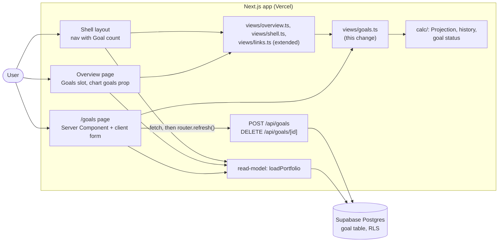

# Design

## Context

See proposal.md (Why) for motivation. The decisions come from the closed wayfinder map [#13](https://github.com/adarsh645-git/finasset-360/issues/13), mainly [#6](https://github.com/adarsh645-git/finasset-360/issues/6) (Goals replace Target Net Worth) and [#19](https://github.com/adarsh645-git/finasset-360/issues/19) (Monthly savings). The screen follows README screen 9 and the prototype's `goalInfo()`, `gl` and `gform` (`Portfolio Tracker.dc.html` on `docs/mockup-handoff`).

By the time this change starts, the earlier eight are merged:
- `redesign-calculations` has the Goal status helper (`goal-status`, GS-01…GS-05; its D13 returns data, not copy) and the Projection with Monthly savings.
- `redesign-data-model` has the `goal` table (`name` nullable, `target_usd > 0`), `POST /api/goals` (`name?`, `target_usd`), `DELETE /api/goals/[id]` (a real delete, DM-35), and `PortfolioData.goals: { id; name: string | null; targetUsd }[]`, sorted by target ascending. A blank name is stored as null (its D12).
- `redesign-shell-and-overview` has the link registry (`src/lib/views/links.ts`: `EXISTING_ROUTES`, `hrefFor`), `buildShell` (D13) with the Goals nav item as plain text and no count, `buildOverview` (D14) with an empty Goals slot in the right column below Needs updating, the chart's `goals` prop set to `[]`, the chart's nearby-goal rule (CH-08), and the formatting helpers (FM-04 compact, FM-08 months, FM-09 "in N mo/yrs").
- `redesign-growth` has the horizon and Monthly savings inputs.

Governing ADRs: 0004 (archive, not delete; Goals are the stated exception, since they have no history) and 0009 (Goals compare against the nominal total).

## Goals / Non-Goals

**Goals:**
- Finish the mockup: `/goals`, the Overview Goals card, goal lines and the nav count.
- One place computes Goal rows (status, progress, displayed name), and the page, the Overview card and the chart labels all read it.

**Non-Goals:**
- Any new route, schema or calculation. This change only composes what earlier changes built.
- Changing the chart primitive's line-filtering rule, which is the `charts` capability's.

## Architecture

The change adds one screen view-model and fills three slots that earlier changes left open.

- **Read path:** the page calls `loadPortfolio(supabase, today)`, then `buildGoalsPage(data, today)`. The Overview's `buildOverview` calls `goalRows(data, today)` for its card and chart lines.
- **Write path:** the client form and each Remove button `fetch` the data-model's routes, then call `router.refresh()`, as every UI change does.

## Decisions

### D1. Goals replace Target Net Worth; one Goal row builder serves every surface
`src/lib/views/goals.ts` exports `goalRows(data, today)`, which returns each Goal's id, displayed name, target, status (kind, label, colour), progress text, bar percent and bar colour, in the read model's order. `buildGoalsPage`, the Overview card and the chart lines all use it, so the three surfaces can't disagree. ([#6](https://github.com/adarsh645-git/finasset-360/issues/6))
- *Alternatives:* a builder per surface, rejected because the status would be computed three ways; putting Goal rows inside `overview.ts`, rejected because the Goals page owns them and Overview only reads them.

### D2. Status from one all-Countries nominal series, built once, ignoring view state
`goalRows` builds one Net Worth series through `calc/`: recorded history from the earliest Valuation (month-ends plus today), then the Projection over the User's horizon, including Monthly savings, savings growth and freed payments. It calls the calc Goal status helper for each Goal. It takes no view state: not the Overview range, not the projection toggle (the chart trims projected points on the client; shell D8), and not Growth's Country scope or Today's dollars. ([#6](https://github.com/adarsh645-git/finasset-360/issues/6): "always uses the all-Countries nominal total and ignores view state")
- *Alternative:* reuse the Overview chart's series. Rejected: that series is cut to the selected range, so a Goal reached before a 1Y window would read as unreached (GO-04).

### D3. Copy and colours follow `goalInfo()`
- Reached → "Reached ⟨Mon YYYY⟩" in the positive colour.
- Projected → "Projected ⟨Mon YYYY⟩ · ⟨in N mo | in N yrs⟩", using the shared FM-08 and FM-09 helpers.
- Beyond → "Beyond the ⟨horizon⟩-year projection", with a blank horizon resolved to 10 by calc.
- Progress → "⟨compact Net Worth⟩ of ⟨compact target⟩" (FM-04). The bar is the whole-percent progress, positive at 100% and ink below.
- "Reached" sticks after a dip, so a Reached Goal can show a bar under 100% in ink (GO-07). ([#6](https://github.com/adarsh645-git/finasset-360/issues/6): Reached sticks; progress clamped 0–100%)
- *Alternative:* turn the bar green whenever the status is Reached. Rejected: the prototype colours by progress, and the bar would contradict the "$140K of $150K" text beside it.

### D4. Savings-aware subtitle
The subtitle is "Projected dates use the country-specific growth rates set on the Growth page, current loan payments and your monthly savings. Amounts are nominal." It is plain text, as in the mockup, with no link to Growth. ([#19](https://github.com/adarsh645-git/finasset-360/issues/19))
- *Alternative:* the prototype's "…and no new savings". Rejected by #19, since savings are in the engine.

### D5. A blank name is stored blank and displayed as "⟨compact target⟩ net worth"
The form sends the trimmed name, or no name when it is blank. `displayName(goal)` returns the trimmed name, or FM-04's compact target plus " net worth". Every surface (page, card, chart label) uses it. ([#6](https://github.com/adarsh645-git/finasset-360/issues/6); `redesign-data-model` D12)
- *Alternative:* the prototype's default name written at save. Rejected by data-model D12, which keeps formatting out of the write route. Display-time naming also follows any later change to the compact format.

### D6. Target parsing is a pure function, checked again on the server
`parseGoalTarget(text)` removes `$`, commas and whitespace and parses the rest as a number. It returns the number only when it is finite and > 0; anything else ("", "0", "-5000", "150k") returns nothing. The form then sends nothing and keeps what was typed, as the prototype does silently. The route's own `target_usd > 0` check (DM-34) is the safety net. ([#6](https://github.com/adarsh645-git/finasset-360/issues/6))
- *Alternatives:* accept "150k" or "1.5M" shorthand, rejected because the mockup doesn't and it adds parsing rules; show an inline message, rejected because the mockup has no error slot on this form. A failed request (network or server) is the exception: it shows the route's message in one line under the form, so a save is never lost silently.

### D7. The add form is a real `<form>`
Name and target inputs and an "Add goal" submit button sit in a `<form>`, so Enter in either input adds the Goal. The target input has `inputmode="decimal"` and a "$" prefix. After a successful save the form clears and the page refreshes, and the new card appears in its sorted place (the read model sorts).
- *Alternative:* the prototype's click-only button. Rejected: Enter-to-submit costs nothing and matches the modal forms.

### D8. Remove is immediate and permanent
Remove calls `DELETE /api/goals/[id]` and refreshes, with no confirm step, as in the prototype. It is a real delete, not an archive ([#6](https://github.com/adarsh645-git/finasset-360/issues/6), ADR 0004's exception). There is no edit control: to change a Goal, remove it and add it again.
- *Alternatives:* "click twice" like Holding delete, rejected because a Goal is two fields and is quickly re-added; an undo toast, rejected as more UI than the mockup has.

### D9. Overview Goals card: next three unreached, hidden when empty
`buildOverview` gets `goals: { rows, allHref } | null`: the first 3 rows of `goalRows` whose status isn't Reached, in target order. It shows name, status and bar, with no amounts, as in the prototype. It is null (card absent) when there is no such row, following [#16](https://github.com/adarsh645-git/finasset-360/issues/16)'s "cards with nothing to show hide". "All goals →" uses `hrefFor('goals')`. On first run (no Holdings or Liabilities) the Overview shows only its first-run card, as shell D14 already rules. ([#6](https://github.com/adarsh645-git/finasset-360/issues/6))
- *Alternative:* an empty card with "No goals yet · Add one". Rejected: the nav already leads to Goals, and the shell's rule hides empty cards.

### D10. Goal lines: pass every Goal; the chart decides what is near
`buildOverview`'s `chart.goals` becomes `{ value: targetUsd, label: displayName }` for every Goal. The chart primitive's CH-08 rule draws only those near the shown Net Worth, extends its y-range to include them, and recomputes on the client when the projection toggle trims the series. ([#6](https://github.com/adarsh645-git/finasset-360/issues/6); shell D7, D8)
- *Alternative:* filter in the view-model. Rejected: the view-model doesn't know the client-side projection toggle, and CH-08 already owns the rule.

### D11. The nav: the route family and the count
The first ticket adds `goals` to `EXISTING_ROUTES`, which turns on the Goals nav item (sidebar, tablet tabs, phone tab bar) and "All goals →". `buildShell` sets the Goals item's value to the Goal count as a plain string, "0" included, as the prototype's `String(s.goals.length)` does. The sidebar and the phone tab bar show it; the tablet tabs show labels only, as in the prototype. Active-state rules are already the shell's (SH-03). (Shared brief: link registry)
- *Alternative:* hide the count at 0. Rejected: the mockup shows it, and "0" tells a new User the section is empty.

### D12. Responsive behaviour
The page is a single column capped at 760px, as in the prototype, at every width. The add form wraps: the name takes a full row on phone, with the target and "Add goal" below. Remove and the inputs meet the 40px touch target (shell D5's global rule; Remove gets padding to match). Hand-checked at ~2000px, ~800px and ~390px. ([#16](https://github.com/adarsh645-git/finasset-360/issues/16): responsive ships inside each change)

## Testing Decisions

**Seam (confirmed with the user):** the screen view-models, as pure functions `(PortfolioData, viewState, today) → view`, tested in Vitest under `tests/unit/`. Where a scenario is about markup (a card is absent, a link vs plain text, a drawn and labelled line), a server render with `react-dom/server` `renderToStaticMarkup`. No route test is added: the routes are the data-model's, and DM-34/DM-35 prove the validation and the real delete. No Playwright and no jsdom.

A good test here builds `PortfolioData` by hand (Holdings with Valuations, Projection Assumptions, Goals), injects today, and asserts what the screen shows: labels, order, colours as token names, hrefs. It never asserts on calc internals; calc's own GS tests prove the status math.

| Scenarios | Test file (Vitest, `tests/unit/`) | Seam |
|---|---|---|
| GO-01 … GO-03, GO-05 … GO-07 | `goals-view.test.ts` | Goals view-model |
| GO-04, GO-13, GO-15 | `goals-overview-view.test.ts` | Overview view-model |
| GO-10, GO-11 | `goals-form.test.ts` | `parseGoalTarget`, `displayName` |
| GO-08, GO-09, GO-12 | `goals-page-render.test.tsx` | `renderToStaticMarkup` of the Goals page body |
| GO-14, GO-16 | `goals-overview-render.test.tsx` | `renderToStaticMarkup` of the Overview body and chart |
| GO-17 | `goals-nav-render.test.tsx` | `buildShell` + `renderToStaticMarkup` of the nav |

Each test name starts with its scenario ID (docs/agents/issue-tracker.md), and `npm run spec:coverage` gates them.

**By hand (the user):** layout, wrapping, touch targets, the dotted line's look and the hover, at ~2000px, ~800px and ~390px against the mockup's Goals screen and Overview.

**Prior art:** `tests/unit/empty-portfolio-render.test.tsx` and `cash-holding-form.test.tsx` for server renders, and the shell change's view-model tests for `buildShell`/`buildOverview`.

## Risks / Trade-offs

- [Building a second Net Worth series on the Overview, one for the chart and one for Goals] → It is a few hundred points and pure math. If profiling ever shows a cost, `buildOverview` can pass its full series into `goalRows`. Not done now.
- [Two Goals with the same target have no defined order] → The read model sorts by target only. It doesn't matter to the User, and the tests avoid ties.
- [A silent no-op on a bad target may confuse] → The mockup's behaviour, kept on purpose (D6). The inputs keep their text, so nothing is lost, and the server check backs it up.
- [A Remove misclick loses a Goal] → Two fields to re-add. Accepted (D8).

## Migration Plan

No schema, data or migration: the `goal` table and routes ship in `redesign-data-model`. Deploy is the normal merge. Rollback means reverting the commit; Goals stored meanwhile stay in the table.
