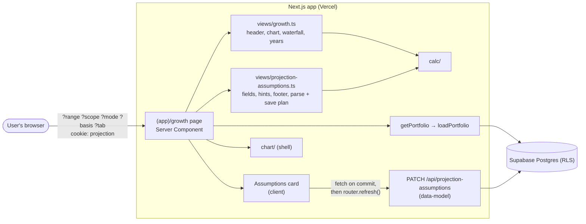

# Design

## Context

See proposal.md (Why) for motivation. The decisions come from the closed wayfinder map [#13](https://github.com/adarsh645-git/finasset-360/issues/13): [#5](https://github.com/adarsh645-git/finasset-360/issues/5) (the assumptions card and horizon), [#19](https://github.com/adarsh645-git/finasset-360/issues/19) (Monthly savings and savings growth), [#4](https://github.com/adarsh645-git/finasset-360/issues/4) (the attribution waterfall) and [#16](https://github.com/adarsh645-git/finasset-360/issues/16) (sequence, empty states, shippable). The mockup is the authority: README screen 8 and the prototype's `gr` block in `renderVals()` (`Portfolio Tracker.dc.html`, lines 1346–1402, markup 575–657).

State when this change starts, after `redesign-update-pass`:
- `loadPortfolio` returns `PortfolioData`, including `assumptions` (percent as entered, blank = null), each Country's `defaults`, the FX history and every Valuation (data-model design, "Read model shape").
- `PATCH /api/projection-assumptions` takes any subset of `horizon_years`, `savings_growth`, `crypto_rate`, `metals_rate`, `other_rate` and `countries.{US,IN}.{inflation, realestate_rate, stocks_rate, cash_rate, monthly_savings}`, with `null` meaning blank, and validates rates −50…50, horizon 1–40 and savings ≥ 0 (data-model D11).
- `src/lib/calc/` provides the Projection (with savings), history sampling, FX by date, Today's dollars, attribution and the shared Asset Class defaults.
- The shell provides the `(app)` layout, request-cached `getPortfolio()`, the chart primitive (date x-axis, trims projected points when the toggle is off), the projection toggle context labelled "N-yr projection on" from the horizon, the format helpers, the `@container` two-column class and the link registry with `ADDING` on (shell design D5, D7–D10, D15).
- `/growth` doesn't exist; the Growth nav item and the Equity built card are plain text.

## Goals / Non-Goals

**Goals:**
- Every number on the page is a call into `src/lib/calc/`, mapped by two pure view-models. The page and the card only render what those return.
- One client component, the assumptions card. Everything else is server-rendered from the URL.

**Non-Goals:**
- Optimistic updates or offline editing of assumptions.
- Caching the Projection across requests: 481 months over a few dozen items is cheap (calc design, Risks).

## Architecture

- **Data flow:** the page reads `PortfolioData` and the search params, calls `buildGrowth(data, view, today)` and `buildAssumptions(data, view, today)`, and renders the result. The card gets its field list as props. On a committed edit it calls the route and `router.refresh()`, which re-runs the page with the new assumptions.
- **Boundary:** the card imports the pure `parseField` and `planSave` from the assumptions view-model, so validation is the same code on the page and in tests.

## Decisions

### D1. View state is in search params; the tab too
`?range=1Y|3Y|5Y|All` (the shell's convention, default All), `?scope=all|us|in` (default all), `?mode=simple|class|country` (default simple), `?basis=nominal|today` (default nominal) and `?tab=us|in`. Unknown values fall back to the defaults (GR-01). Segments are `<Link replace scroll={false}>`, as on the Overview. With no `tab`, it is the scope's Country, or US. Choosing a Country scope also sets the tab, and choosing All keeps it (PA-03, PA-04; the prototype's `ctryOpts` handler). The projection toggle stays the shared cookie and context.
- *Alternatives:* client state for mode, basis and tab (rejected: Back wouldn't restore it, and the server render would be wrong); a per-User stored scope (rejected: [#5](https://github.com/adarsh645-git/finasset-360/issues/5) keeps view state out of the domain).

### D2. The header, waterfall and Year by year are nominal; only the chart switches basis
The header change is Net Worth today minus Net Worth at the range start, both nominal, for the items in scope (GR-02). The basis switch restates only the chart. This matches the prototype, where the header, waterfall and years read `Nn`/`Ln`, and it keeps the waterfall's rows summing to the header ([#4](https://github.com/adarsh645-git/finasset-360/issues/4)). The range start is clamped to the Portfolio's earliest Valuation (calc NH-04, [#16](https://github.com/adarsh645-git/finasset-360/issues/16)).
- *Alternative:* restate the header in Today's dollars too. Rejected: attribution has no Today's-dollars form, and the two cards would disagree.

### D3. The chart's series come from the view-model; projected points are always included
`buildGrowth` returns chart series for the chosen mode, each with dated points from the range start through the end of the horizon, and the chart trims the projected part when the toggle is off (shell D8). The Growth chart always sets the shared chart's `zero: true` (CH-16), so $0 is on the axis as in the prototype's `zero: true`. The modes follow the prototype:
- **Simple:** Net worth (bold), Assets (pos colour, light area), Owed (neg, light area), all end-labelled.
- **By asset class:** stacked class layers, largest current value at the bottom, then Owed and a bold Net worth; only Net worth and Owed are end-labelled. Each layer passes its cumulative top as its points, the layer below as `base`, and its own class values as `tip` (CH-15), so the tooltip shows the class's own value, not the running stack.
- **By country:** one line per Country in scope (Country colour, end label "US" / "India"), plus a bold "Total net worth" (end label "Total") when both are in scope.

One change from the prototype: a class gets a layer when its series is non-zero anywhere in the window, not only when it holds value today. Otherwise Monthly savings, which sit in Stocks (calc D5), would vanish from the layers whenever the User holds no Stocks (GR-07). Today's dollars calls the calc restatement per Country, then sums (calc D10). The subtitle lists the resolved inflation of each in-scope Country to one decimal (GR-10).
- *Alternative:* the prototype's "held today" filter. Rejected for the savings case above.

### D4. The waterfall reads attribution directly and scales across zero
Rows: "Net worth ⟨Mon YYYY⟩", "Asset growth & savings", "Debt paid down", "Currency (₹ → $)" when India is in scope, and "Net worth today" ([#4](https://github.com/adarsh645-git/finasset-360/issues/4), README screen 8). Values come from calc attribution for t0 and the scope, so they sum exactly (calc NH-13). Each bar spans its running total before and after. Totals bars start at 0. The scale runs from min(0, lowest running total) to max(0, highest), so a negative Net Worth still draws. A zero step gets the prototype's 0.6% sliver. Colours: totals ink, steps pos or neg by sign. The view-model returns `from`, `to` and the scale, which keeps GR-13 a numeric test.
- *Alternative:* the prototype's scale with its left edge at 0. Rejected: it mis-draws negative Net Worth.

### D5. Year by year covers all history, at year ends, nominal, scoped
One row per calendar year from the year of the Portfolio's earliest Valuation through the current year, newest first. A row shows Net Worth and debt at 31 December (each at that date's FX Rate, calc D7/D8), or at today for the current year, which is starred. % change is against the previous row's Net Worth, using its absolute value, with "—" for the first row or a previous 0 (prototype). The range doesn't trim it and the basis doesn't restate it (GR-14, GR-15). Amounts use the compact formatter, and % uses whole percent.
- *Alternatives:* add projected years (rejected: the mockup shows history only and the chart covers the future); follow the range (rejected: the prototype lists every year regardless).

### D6. Blank fields show defaults as placeholders; values are percent as stored
The fields map one-to-one onto `PortfolioData.assumptions`. A saved value is shown as stored (7.5, −9) and a blank one is empty, with the default as the placeholder: Country defaults from `PortfolioData.countries[].defaults`, shared class defaults from calc, 0 for Monthly savings and savings growth, and 10 for the horizon ([#5](https://github.com/adarsh645-git/finasset-360/issues/5), [#19](https://github.com/adarsh645-git/finasset-360/issues/19), data-model D11). Monthly savings show grouped in their Country's style (3,000; 1,20,000). Field order: Inflation, Real estate, Stocks, Cash, Monthly savings on the tab; Crypto, Metals, Vehicles & other, Savings growth under "Shared across countries".
- *Alternative:* fill fields with the defaults. Rejected: a typed 7 and a default 7 would look alike, and Reset defaults would be indistinguishable from typing the numbers.

### D7. Saved on commit, one field per request
A field is committed on blur or Enter. `planSave(field, text, saved)` returns `none` (unchanged), `error` (invalid, with its message) or a one-field patch in the route's shape (blank → `null`). The card sends it with `fetch`, then calls `router.refresh()`. A non-OK response shows "Couldn't save. Try again." (or the route's message) under the field and keeps the text. Each request touches one field, so two quick commits can't overwrite each other ([#5](https://github.com/adarsh645-git/finasset-360/issues/5): "saved live").
- *Alternatives:* debounced saves on every keystroke (rejected: refreshes mid-typing, and racing requests); a Save button (rejected: the mockup has none).

### D8. The card validates with the route's ranges
`parseField` ignores commas, spaces, "%", "$" and "₹", and reads U+2212 as a minus. Rates and savings growth must be −50…50, the horizon a whole number from 1 to 40, and Monthly savings ≥ 0. The messages are "Enter a rate from −50 to 50", "Enter whole years from 1 to 40" and "Enter an amount of 0 or more". The route stays the authority (data-model D11). The card only avoids a pointless round trip.

### D9. Reset defaults sends every field as null in one request, with no confirmation
It blanks rates, both Countries' Monthly savings, savings growth and the horizon, which "blanks everything" ([#5](https://github.com/adarsh645-git/finasset-360/issues/5)). It is one request, so the page never shows a half-reset state. There's no confirmation, matching the mockup. The values are a few numbers the User can retype.
- *Alternative:* leave the savings amounts and horizon alone. Rejected: the brief and #5 say everything.

### D10. The horizon input sits in the card header; the toggle label is the shell's
"Horizon [ ] yrs" sits beside Reset defaults ([#5](https://github.com/adarsh645-git/finasset-360/issues/5)). The shell already labels the toggle from `assumptions.horizonYears ?? 10` (shell `charts` spec), so a saved horizon relabels every page after the refresh (PA-14). No shell code changes. The footer's end month is today's month plus the horizon.

### D11. The footer is the Projection's last month, for the scope
Nominal is the scoped Net Worth at month horizon × 12. Today's dollars restates each in-scope Country at its own inflation over those whole months, then sums (calc D10). Lost to inflation is the difference. It ignores the chart basis and the projection toggle, and it includes Monthly savings. So with nothing held it still shows what the savings grow to (PA-13).

### D12. The empty state is the Overview's first-run rule
The page is empty when there are no current Holdings and no current Liabilities, the same test as the Overview's first run (shell D14). It shows a header ("Growth"), one card ("Nothing to chart yet" with an "Add an account or asset" link to `?modal=add-asset`), then the assumptions card with its footer. Controls, chart, waterfall and Year by year are absent ([#16](https://github.com/adarsh645-git/finasset-360/issues/16)). A brand-new item is not empty: it gets a one-point history and a "—" year (GR-17).
- *Alternative:* add an "or a loan" link too. Rejected: #16 asks for one link, and the Liabilities page already has its own.

### D13. The incoming links are one registry entry
The first ticket adds `growth` to `EXISTING_ROUTES` in `src/lib/views/links.ts`. That turns on the Growth nav item in all three nav forms and the Equity built card's target, which shell already routes through `hrefFor("growth")` (shell D9, D14). GR-18 and GR-19 are this change's own tests of that wiring.

### D14. Amount-held hints
On a Country tab, each class hint is that Country's current value in the class in USD, compact ("$100K held"), or "none held" (prototype `heldIn`). Shared-class hints sum both Countries. Inflation reads "Used for today's dollars". The mockup has no copy for the two inputs added by [#19](https://github.com/adarsh645-git/finasset-360/issues/19), so it is decided here. Monthly savings reads "$ per month, invested at the Stocks rate" (₹ on the India tab, with a ₹ or $ prefix in the field). Savings growth reads "Raises monthly savings once a year".

### D15. Responsive rules
The waterfall and Year by year sit in the shell's `@container` two-column class and stack under 820px of content width. The header's controls and the chart's control row wrap. The assumption grids use `repeat(auto-fit, minmax(200px, 1fr))`. The chart's phone rules come from the primitive. Global 40px targets and 16px phone inputs come from the shell (D5). Year by year keeps all four columns on phones, because they fit at 390px.

## Testing Decisions

**Seams (confirmed with the user):** the screen view-models in Vitest (seam 3), with `renderToStaticMarkup` for markup scenarios. Tests build `PortfolioData` fixtures by hand and inject today. They assert what the screen shows (rows, labels, order, presence, link targets and save plans), never component internals. The calculations module (seam 1) is already proven by `redesign-calculations`. Its results are the oracle for chart points, but never re-derived in the test. There are no route tests: this change adds no route, and data-model's DM-34…DM-38 cover `PATCH /api/projection-assumptions` under RLS. No Playwright or jsdom.

| Scenarios | Test file (`tests/unit/`) | Seam |
|---|---|---|
| GR-01 … GR-15, GR-17 | `growth-view.test.ts` | `buildGrowth` |
| GR-16 | `growth-render.test.tsx` | static render of the Growth page body with an empty fixture |
| GR-18, GR-19 | `growth-links.test.tsx` | `buildShell`/`buildOverview` with `growth` registered; static render of the three nav forms |
| PA-01 … PA-04, PA-12, PA-13 | `projection-assumptions-view.test.ts` | `buildAssumptions` |
| PA-05 … PA-11 | `projection-assumptions-save.test.ts` | `parseField`, `planSave`, the Reset defaults plan |
| PA-14 | `projection-assumptions-view.test.ts` | the shell's toggle label and `buildAssumptions` footer, both from a fixture with horizon 15 |

Each test name starts with its scenario ID, and `npm run spec:coverage` gates them.

**By hand (the user, against the mockup's Growth screen):** at 2000px, 800px and 390px, the header controls, the chart card's title row and control row, end labels hidden on phone, the legend below, the assumption grid reflow, and the two-column row stacking around 820px of content. Also typing, blurring and Enter in the card, with the chart and footer updating after a save. Every hand check names its width.

**Prior art:** `tests/unit/empty-portfolio-render.test.tsx` (static render, mocked `next/navigation`), and the shell's `overview-view.test.ts` for fixture style.

## Risks / Trade-offs

- [A save followed by `router.refresh()` re-runs the read model and the Projection on each commit] → One commit per field, a few dozen items, and 481 months: it's milliseconds. The read model is already cached per request.
- [Two tabs editing the same field] → Last write wins per field. Single-User data makes it harmless.
- [The client validation drifts from the route's] → The route is the authority and its message is shown. The ranges are written once in the view-model and asserted by PA-05…PA-07.
- [Year by year over a long history is a long list] → One row a year; even 30 years is short.
- [The class-layer rule differs from the prototype] → Only when savings or a class that sells to 0 within the window are involved. D3 records why.

## Migration Plan

No schema, data or environment changes. Deploying adds `/growth` and turns on its two incoming links. Rollback means reverting the merge, which brings back the plain-text nav item and card.

## Open Questions

None that change the specs or the tickets. The empty card's copy and the two savings hints can be adjusted during review.
