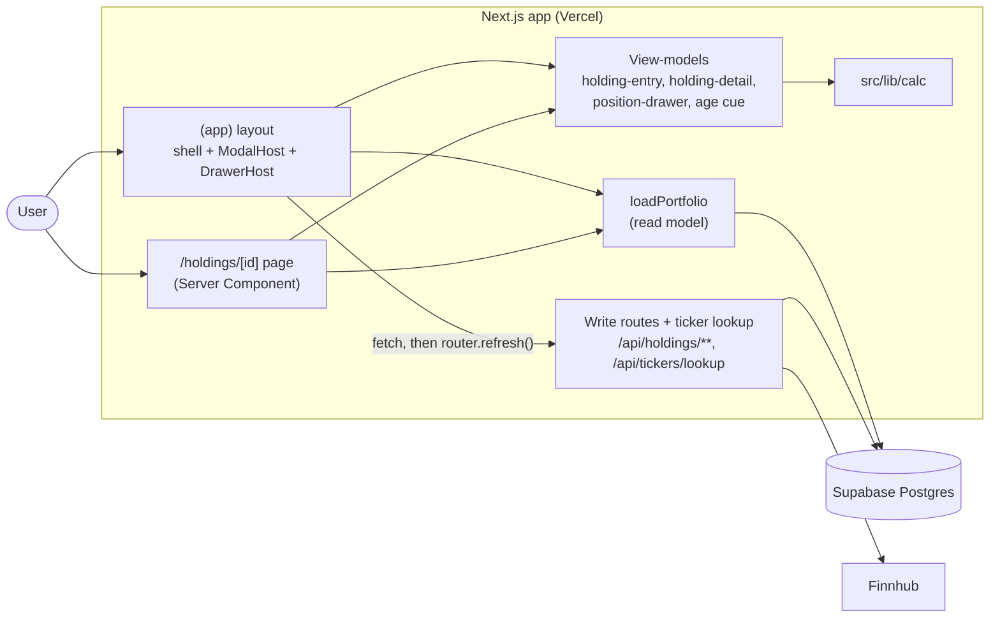
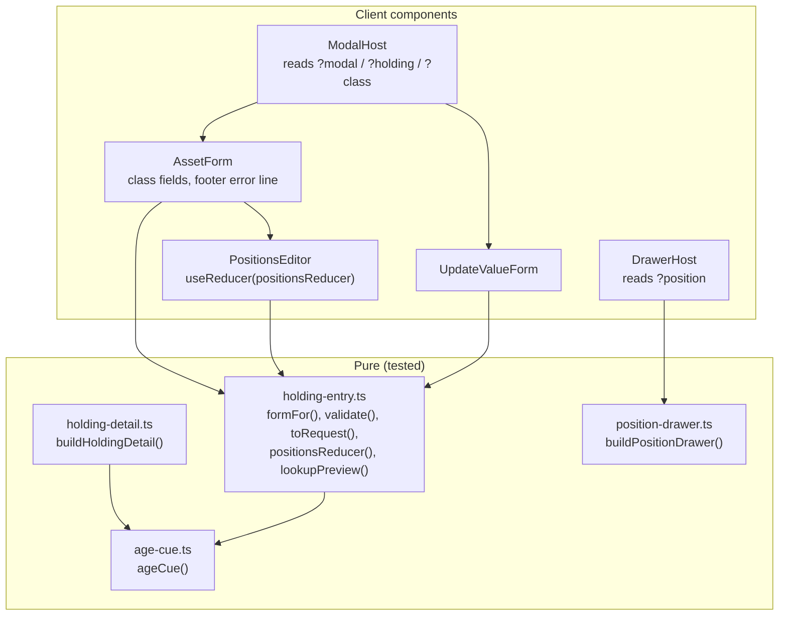

# Design

## Context

See proposal.md (Why). The decisions come from the closed wayfinder map [#13](https://github.com/adarsh645-git/finasset-360/issues/13) and its tickets. The screens follow the mockup handoff's sections 4 (detail), 5 (drawer) and 10 (modal), and `save()`, `addPos()`, `posInfo()`, `openEditHolding()` and the `hd`/`fm`/`drawer` blocks of `renderVals()` in `Portfolio Tracker.dc.html` (on the `docs/mockup-handoff` branch). The mockup is the authority over the current code and `docs/SPEC.md`.

What this change builds on:
- **`redesign-calculations`** (`src/lib/calc/`): history and sample dates, FX by date, 12-month change, Currency effect (attribution), the Projection and staleness.
- **`redesign-data-model`**:
  - `loadPortfolio(supabase, today) → PortfolioData`, which includes archived Holdings, Positions with `priceSource` / `priceAsOf` / `exchange`, and Valuations with `source`.
  - The routes this change calls:
    - `POST /api/holdings`;
    - `PATCH /api/holdings/[id]` (full replacement; `asset_class` and `country` must match);
    - `POST /api/holdings/[id]/valuations` (non-Stocks only);
    - `POST /api/holdings/[id]/archive` (unlinks loans; there is no permanent delete);
    - `GET /api/tickers/lookup?ticker=&country=`.
  - Invalid input returns `400 { error }` with one plain sentence.
  - Server-side rules: Sector defaults to Other and name to the ticker; a Hand Price is re-dated to today only when its price changes, or for every Hand Price when the request carries `confirm_prices: true` (data-model D6); duplicate tickers are rejected; `.NS` is added for India.
- **`redesign-shell-and-overview`**:
  - The `(app)` layout and responsive frame, and the `@container` two-column class (stacks under 820px of content).
  - `src/lib/format/` (FM-01…FM-10), the chart primitive, and the projection context seeded from the cookie.
  - The link registry `src/lib/views/links.ts` (`EXISTING_ROUTES`, `hrefFor`, `ADDING`).

Today's code is still the old Miller app until `redesign-data-model` deletes it. Nothing old is reused.

Governing ADRs: 0004 (archive, don't delete), 0005 (Stocks accounts of Positions), 0006 (fixed Asset Classes), 0008 (dated Valuations, FX by date).

## Goals / Non-Goals

**Goals:**
- A User can add, edit, update and archive every kind of Holding in production, with the mockup's copy and behaviour.
- Every screen is decided by a pure view-model or reducer, so each HE, HD and PD scenario is a unit test without a browser.
- The modal host and drawer host work on every page, so later changes (`redesign-asset-pages`, `redesign-liabilities`, `redesign-update-pass`) only add to them.

**Non-Goals:**
- Route contracts, validation on the server, and the read model. They are `redesign-data-model`'s, and this change only calls them.
- The loan form and the Asset | Liability toggle; the linked-loan card, "Your equity" and the value-vs-loan chart. `redesign-liabilities` adds them.
- The guided pass (`redesign-update-pass`).

## Architecture

The change is UI inside the one Next.js container. Server Components read the Portfolio, pure view-models shape it, and client components write through the existing routes and then refresh.

- **Data flow:**
  - The layout calls `loadPortfolio` and passes plain data to `ModalHost` and `DrawerHost`.
  - The page calls `loadPortfolio` again, and React `cache()` dedupes the two calls within one request.
  - After any write, the client calls `router.refresh()`, which re-renders the layout and page with fresh data.
- **Boundary:** view-models take `(PortfolioData, viewState, today)` and return exactly what renders: labels, rows, `href | null` and which cards exist. Components hold no business rules.

## Decisions

### D1. The modal host lives in the `(app)` layout and reads the URL
A client `ModalHost` mounted once in the `(app)` layout reads `modal`, `holding` and `class` with `useSearchParams`. It finds its Holding in the layout's `PortfolioData` and renders nothing for params that name nothing:
- an archived Holding or an unknown id;
- `modal=add-liability` before `redesign-liabilities`;
- an unknown `class`, which falls back to Stocks.

Entry points open the modal with a `<Link>` that keeps the page's other params. Closing removes only the modal params (`router.replace`), so Back after opening returns to the clean page. (Brief: search-param state; HE-01…HE-03)
- *Alternatives:*
  - Each page renders its own modal. Rejected: every page in the shell has "+ Add", and `redesign-update-pass` needs one host.
  - Client-only state. Rejected: Back wouldn't close the modal, and the update pass needs the URL.
  - An intercepting route. Rejected: it's more machinery than three params.

### D2. One dialog component; bottom sheet below 640px
The same component is a top-aligned dialog (`max-width: 560px`, 6vh top padding) from 640px, and a bottom sheet below it: full width, top radius 16, `max-height: 92vh`, scrolling inside. The header holds the title and ×, the body holds the fields, and the footer holds the error line, Cancel and Save. Esc and a backdrop click close it, and focus is trapped while it's open. On phone, inputs are 16px so iOS doesn't zoom, and controls are at least 40px tall (the shell's global rule). This is verified by hand at 2000px, 800px and 390px. ([#16](https://github.com/adarsh645-git/finasset-360/issues/16), README Responsive)
- *Alternative:* a separate phone component. Rejected: two components would drift apart.

### D3. The asset form follows the mockup per Asset Class
Class chips come first in the fixed order. Then the Name, whose label and placeholder follow the class (HE-04), "Held in" (US default), and Description. Then each class's fields:
- Stocks: the positions editor.
- Real estate: Property type chips (Residential default) and City / location.
- Metals: Quantity, and a Grams / Troy oz unit (Grams default).
- Every class except Stocks: Current value and Cost basis (optional).

Switching class keeps shared fields (HE-06). Titles and save labels use the class noun (HE-01). ([#1](https://github.com/adarsh645-git/finasset-360/issues/1), [#2](https://github.com/adarsh645-git/finasset-360/issues/2), [#18](https://github.com/adarsh645-git/finasset-360/issues/18))
- **Placeholders:** the mockup's "e.g. Gold coins" also covers Crypto and Other. Those two get "e.g. Coinbase" and "e.g. 2022 Honda CR-V" (taken from the sample data).
- *Alternative:* one placeholder for all three. Rejected as a sample-data accident.

### D4. Description is a new optional field under Name
The mockup has no input and stamps boilerplate, so [#1](https://github.com/adarsh645-git/finasset-360/issues/1) adds one: "Description (optional)", trimmed, with nothing stored when blank. It shows on the native line and nowhere else in this change.

### D5. Edit leaves out Asset Class and Country
The edit form drops the class chips and "Held in" and keeps the Holding's class and Country, because `redesign-data-model` D4 fixes both after creation. Changing them means archive and re-add. (Brief Addendum 2; HE-07)
- *Alternative:* show them locked. Rejected: a control that can't be used invites a click, and the coordinator asked for them to be left out.

### D6. Validation copy from `save()` / `addPos()`, checked in the client first
`validate(form)` returns the first failure, in the prototype's order: "Give it a name", "Add at least one position", "Enter the current value" (HE-08). Amounts strip `$`, `₹`, commas and spaces (HE-09), and a blank optional field is sent as absent (HE-10).
- **Addition:** a typed but unadded ticker blocks Save with "Add ⟨ticker⟩ or clear it first". Without it, a Position the User believed was entered is silently lost.
- **Server rejections:** if the route still rejects, its `400 { error }` sentence shows in the same footer line, and the form keeps its values (HE-12). Save is disabled while a request is in flight.
- *Alternative:* server-only validation. Rejected: every mistake would cost a round-trip, and the mockup's messages are client-side.

### D7. The positions editor is a pure reducer
`positionsReducer(state, action)` holds the listed Positions, the entry row (ticker, shares, avg cost, price, Sector, name), the latest lookup result and the error. Actions: `type`, `lookupResolved`, `add`, `remove`. Everything HE-13…HE-21 checks is a reducer or selector output. ([#1](https://github.com/adarsh645-git/finasset-360/issues/1), [#12](https://github.com/adarsh645-git/finasset-360/issues/12))
- **Ticker key:** upper-cased and trimmed; for India, `.NS` is added when the ticker has no `.` (the prototype's `tickerKey`). The display drops `.NS`/`.BO` (HE-14).
- **Lookup:** `GET /api/tickers/lookup` runs 300ms after typing stops. Only the response for the current key is applied. Add waits for a pending lookup.
- **Preview copy:**
  - With market data: "⟨name⟩ · ⟨Sector⟩ · ⟨price⟩ · ⟨exchange⟩".
  - Unknown with a `/search` name: "⟨name⟩ · no market price. Enter its price and Sector."
  - Unknown without one: "No market price for ⟨ticker⟩. Enter its price and Sector."
  - Empty: the prototype's "Try …" hints.
  - The mockup's "sample data" wording is dropped, as is the footnote about a sample list. The footnote becomes "Price, name and Sector are looked up from the ticker. Tickers without market data take the price you enter."
- **Unknown ticker:** shows Current price, a Sector select (the 12 Sectors) and a Name input, which the mockup lacked and #12 requires. The Name is pre-filled from the lookup's name. The Sector defaults to Other, matching the server default and #12's note that funds are usually Other; the prototype's Technology was sample convenience.
- **Add:** checks in order "Enter a ticker", "Enter number of shares", "Enter a price for ⟨ticker⟩" (the prototype's sample-data message, reworded). A blank avg cost defaults to the price. The new row replaces any row with the same key, so a save never carries duplicates, which the route rejects. The entry row then clears.
- **Re-typing a listed ticker** pre-fills its shares, avg cost, Hand Price, Sector and name from the list ([#12](https://github.com/adarsh645-git/finasset-360/issues/12) addition).
- **Rows:** "⟨shares⟩ sh · avg ⟨avg⟩ · now ⟨price⟩ · ⟨Sector⟩", a native value and ×. A stale Hand Price adds "· price N days old" (D12). The header shows the running native total.
- *Alternatives:* look up only on Add (rejected: the mockup previews while typing); a form library (rejected: one reducer is enough and is testable as is).

### D8. Requests are built by one pure function
`toRequest(form, holding?)` returns `{ method, url, body }`:
- add → `POST /api/holdings`;
- edit and Edit positions → `PATCH /api/holdings/[id]`, a full replacement that resends class and Country unchanged;
- Update value → `POST /api/holdings/[id]/valuations`.

Stocks bodies carry the whole list as `{ ticker, shares, avg_cost?, hand_price?, sector?, name? }`, with Hand Price, Sector and name only for Positions without market data (HE-24, HE-25). After success the client calls `router.refresh()`. An add then goes to `/holdings/⟨new id⟩` (HE-11, the prototype's `go('holding')`), and edits close the modal in place.

### D9. Update value and Edit positions
- **Update value** (non-Stocks): one 48px-tall input pre-filled with the current value, and "Was ⟨current⟩ · logged as today's value, ⟨Oct 14, 2026⟩". Saving always posts, so an unchanged value still records today's Valuation and clears staleness (HE-22, HE-23). ([#8](https://github.com/adarsh645-git/finasset-360/issues/8))
- **Edit positions** (`modal=update` on a Stocks Holding): the prototype opens its full edit form here, so this change does the same with the title "Edit positions" (HE-01, HE-24). A Hand Price is re-dated only when its price changes, so renaming the account or editing another Position leaves staleness as it was. The plain form never sends `confirm_prices`. The request takes the flag only when a caller passes it through D19 (the update pass).
- *Alternative:* a positions-only sheet. Rejected: it's not in the mockup, and the full form costs nothing extra.

### D10. Holding detail is one view-model over `PortfolioData`
`buildHoldingDetail(data, { holdingId }, today)` returns the header, actions, stats, positions, sectors, chart series and log, or `null` (→ `notFound()`) for archived, unknown or foreign ids. RLS already hides foreign ones (HD-01).
- **Breadcrumb:** the "Assets" crumb uses `hrefFor(assets)` and the class crumb `hrefFor(assetClass(id))`, so both stay plain text until `redesign-asset-pages` registers those routes (HD-04).
- **Kind tag:** follows the class noun. Stocks is always "Brokerage account", fixing the prototype's "Asset" for a positionless sample ([#2](https://github.com/adarsh645-git/finasset-360/issues/2)).
- **Native line:** for India, "⟨₹⟩ at ₹⟨rate⟩/$", plus "as of D Mon" when today's FX Rate is older than today, as on Overview (OV-15). Then the Description, then the Stale cue (HD-03, HD-05).
- **Layout:** the Positions and By sector cards use the shell's `@container` two-column class and stack under 820px.

### D11. Stat cards: the prototype's list, with calc's 12-month rule
The order is Property, Cost basis, Unrealized gain, Quantity, 12-month change, Currency effect, 12 mo, then an empty slot for `redesign-liabilities`' "Your equity". Sub-labels follow the prototype:
- Cost basis: "≈ $X today" for India, otherwise "What you paid".
- Unrealized gain: the % plus the USD gain for India.
- Quantity: "⟨value ÷ quantity⟩ per ⟨unit⟩".
- Currency effect: "₹then → ₹now per $".

The 12-month change comes from calc (D9). For an item with no Valuation 12 months ago it reads "—" with the sub-label "Added ⟨Mon YYYY⟩", not the prototype's "since added" figure, matching "never +100%" ([#16](https://github.com/adarsh645-git/finasset-360/issues/16)). The Currency effect is calc attribution's term for this one Holding from today − 12 months (HD-08…HD-12).
- *Alternative:* the prototype's since-added change. Rejected: it contradicts calc D9, which Overview and the class pages also use.

### D12. One age cue, owned here
`ageCue(kind, ageDays)` in `src/lib/views/age-cue.ts` returns nothing when the item isn't Stale. Otherwise it returns "N days old" for a manually valued Holding or a Liability, "prices N days old" for a Stocks Holding, and "price N days old" for a hand-priced Position. It's built on calc staleness and the shell's age format (FM-10). `redesign-asset-pages` and `redesign-liabilities` reuse it for their rows (HD-23). This change applies it to Position rows on the detail page and in the editor (HD-16, HE-21), and adds "· updated N days ago" on the detail native line. ([#8](https://github.com/adarsh645-git/finasset-360/issues/8))
- *Alternatives:* dimming rows (rejected in #8); flagging only the Holding (rejected: Edit positions would then not show which price to re-type).

### D13. Positions and By sector
Rows are sorted by USD value, descending. The weight is the share of the account's USD value (whole %), and the gain is (price − avg) ÷ avg as a whole %. By sector groups by Sector with its tickers and a share to one decimal (HD-13, HD-14). The sub-heading is "⟨N⟩ positions"; the prototype's "click a row to open it on Yahoo Finance" is wrong, because a row opens the drawer.
- **Phone:** rows drop the shares count and the weight and gain columns (README Responsive), keeping ticker, name, price and value.

### D14. Chart and Value log
- **Chart:**
  - The series is the Holding's USD value from calc history: interpolated, sampled at month-ends plus today, starting at the first Valuation (calc NH-04), at each date's FX Rate.
  - The calc Projection follows, for this Holding at today's FX Rate. The chart trims it when the projection toggle is off.
  - The x-axis is by date. The sub-title follows HD-18.
  - A brand-new Holding gives one recorded point (HD-19).
- **Value log** ([#4](https://github.com/adarsh645-git/finasset-360/issues/4)):
  - Manual Holdings list every Valuation.
  - Stocks list the last Valuation of each month before the current month, plus today's current value. This is calc D7's "current value is today's Valuation", so the log agrees with the headline.
  - Newest first; the oldest row says "· added", and the change is "+amount · +%" or "—".
  - Dates: "Oct 14, 2026" for day rows and "Sep 2026" for month rows.
  - All rows are shown. The prototype's 8-row cut is a sample-data limit.
- *Alternative:* a cap with "Show all". Rejected (YAGNI): a monthly habit gives about 12 rows a year.

### D15. Delete is a two-click archive
A reusable client `ConfirmDeleteButton` (props: the archive URL and where to go after) shows "Delete", and its first click turns the label to "Confirm delete". The state resets when the User leaves the page; `redesign-liabilities` reuses the button for loans. The second click posts `/archive`, which unlinks loans server-side, then `router.push('/')` and `router.refresh()`. The prototype goes to the class page, which doesn't exist until `redesign-asset-pages`, so that change switches the target. Archived Holdings keep their history (ADR 0004; HD-07).
- *Alternative:* a confirm dialog. Rejected: the mockup uses the two-click button.

### D16. The drawer host lives in the layout too
A client `DrawerHost` in the `(app)` layout reads `position=<holdingId>~<ticker>`. It splits at the last `~`, so tickers never contain one. It finds the Position among current Stocks Holdings and renders `buildPositionDrawer(data, key, today)`. That way any page that lists Positions (the detail page now, the Stocks class page in `redesign-asset-pages`) only links rows to `?position=` (PD-01).
- **Panel:** a right-side panel `width: min(400px, 100%)` over a dimmed backdrop. × / backdrop / Esc remove only `position` (PD-02).
- **Stats:** six, in a 2×3 grid (PD-04, PD-05).
  - The Price sub-label is "Market price", because the read model has no market price date (RM spec), or "as of D Mon" for a Hand Price.
  - Weight in stocks is the share of all current Stocks Holdings in USD.
- **Yahoo link:** shown when `priceSource = market` or the ticker ends `.NS`/`.BO` ([#12](https://github.com/adarsh645-git/finasset-360/issues/12); PD-06). The prototype's "Prices are sample data" note is dropped.
- *Alternative:* the drawer only on Holding detail. Rejected: the Stocks class page needs it too (asset-pages asked for a layout-level host).

### D17. Entry points through the link registry
Ticket 1 adds the `holding` family to `EXISTING_ROUTES` and sets `ADDING = true` in `links.ts`. That turns on the Overview Equity rows and the Needs updating Holding rows (HD-22), the sidebar's "+ Add account or asset", the top bar's "+ Add" and the first-run Add. All of these open `?modal=add-asset` on the current path (HE-26, HE-27). The "or a loan" link stays off until `redesign-liabilities`. (Brief Addendum)

### D18. Formatting additions
The shell's `src/lib/format/` has no full-date shape. This change adds two helpers there, beside FM-08, without changing any existing one: `formatDay` ("Oct 14, 2026") for the Value log and the Update value line, and `formatDayMonth` ("3 Aug") for "as of". If shell-and-overview already exported a "D Mon" helper for OV-15, this change reuses it instead of adding one.

### D19. Extension points for later changes
`redesign-liabilities` and `redesign-update-pass` build on this change. These seams are part of this change's contract, so they don't edit its internals:
- **Modal modes:**
  - `ModalHost` resolves the params through a small mode table: `add-asset`, `edit` + `holding`, `update` + `holding`.
  - Later changes register more rows, e.g. `add-liability`, `edit` + `liability`, `update` + `liability`. An unregistered combination renders nothing (HE-02).
  - The dialog frame (D2) takes a title, body, footer error and save label. In add mode, its header has a slot for the Asset | Liability toggle, which switches `modal=add-asset` ↔ `modal=add-liability` with `router.replace`. This change leaves the slot empty.
  - Its footer has a slot for update-pass's "Save & next" and "i of N".
  - `ModalHost` keeps any extra search params it doesn't own, including `pass` and `from`, when it opens, re-renders or closes. It also accepts mode rows that don't target a Holding, such as `pass-summary`, which another change registers.
  - Every form component takes an optional `confirmPrices` flag, off by default. When the caller sets it, the Stocks request adds `confirm_prices: true`.
  - Every form component takes an optional `onSaved(result) → url | null`. By default it closes the modal; a URL makes the host navigate there instead, which is how the update pass steps to its next item.
- **Holding detail slots** (in `buildHoldingDetail`'s output and the page):
  - `stats` ends with an optional "Your equity" card, appended last.
  - `linkedLoan` is a card after Positions / By sector and before the chart.
  - `chart.series` is a list the liabilities view-model may replace with value, loan balance and the shaded equity gap; the title becomes "Value vs. loan".
  - This change always returns them empty or default.
- **Stale cues:**
  - `ageCue` (D12) phrases rows.
  - `updatedCue(ageDays)` returns "· updated N days ago", or "Updated N days ago" for an empty line. It is the detail page's native-line suffix, which Loan detail reuses.
- **Delete:** `ConfirmDeleteButton` (D15).
- *Alternative:* let each change edit these components freely. Rejected: three parallel changes touching one file would conflict, and the slots keep each change's diff in its own files.

## Testing Decisions

**Seams (confirmed with the user):** two of the three agreed seams. Each test drives a public function with plain `PortfolioData`, view state and an injected today, and asserts only what the User would see.
- **Screen view-models** (seam 3): `holding-entry.ts` (`formFor`, `validate`, `toRequest`, `positionsReducer`, `lookupPreview`), `holding-detail.ts`, `position-drawer.ts` and `age-cue.ts`.
- **Server render** (`react-dom/server` `renderToStaticMarkup`) where a scenario is about markup: which fields render in the edit form (HE-07), link vs plain text (HD-04, HD-22, HE-26, HE-27), and absent sections (HD-17, PD-06's absent link).
- **Not used:** the route seam. The routes belong to `redesign-data-model`, whose route tests cover them, and this change adds no route.
- The lookup `fetch` is never called in tests: the reducer receives `lookupResolved` actions directly.
- There's no Playwright, no jsdom and no Testing Library.

**Oracles:** hand-computed figures in the scenarios (e.g. 6,200,000 ÷ 83.40 = $74,341; Currency effect 6,200,000 × (1/83.40 − 1/82.10) = −$1,177), and the prototype's copy.

| Scenarios | Test file (Vitest, `tests/unit/`) | Seam |
|---|---|---|
| HE-01 … HE-03, HE-26 | `holding-entry-modal-state.test.ts` | View-model (`formFor`, close href), server render for HE-26 |
| HE-04 … HE-12, HE-22 … HE-25 | `holding-entry-form.test.tsx` | View-model (`formFor`, `validate`, `toRequest`), server render for HE-07 |
| HE-13 … HE-21 | `holding-entry-positions-editor.test.ts` | `positionsReducer`, `lookupPreview` |
| HE-27, HD-22 | `holding-entry-links.test.tsx` | Overview view-model + server render with the registry on |
| HD-01 … HD-21 | `holding-detail.test.tsx` | `buildHoldingDetail`, server render for HD-04, HD-17 |
| HD-23 | `age-cue.test.ts` | `ageCue` |
| PD-01 … PD-07 | `position-drawer.test.tsx` | `buildPositionDrawer`, server render for PD-06 |

Each test name starts with its scenario ID, and `npm run spec:coverage` gates them.

**By hand (the user, against the mockup):** the modal as a dialog at 2000px and 800px and as a bottom sheet at 390px (scrolling inside, 16px inputs, 40px targets); the positions editor's Enter-to-add and preview while typing; the detail page's two-column stacking around 820px of content and the dropped Positions columns at 390px; the drawer at 2000px and full width at 390px; chart hover and touch on the detail chart. Every hand check names its width.

**Prior art:** `tests/unit/cash-holding-form.test.tsx` and `empty-portfolio-render.test.tsx` (server render), and the shell's view-model tests. Their style carries over, but not their types.

## Risks / Trade-offs

- [The layout and page both read the Portfolio] → React `cache()` dedupes within a request. Writes call `router.refresh()`, which re-renders the layout, so the modal never edits stale data from this tab. Another tab's edits show after the next navigation refresh.
- [A User confirms an unchanged Hand Price in Edit positions, but it stays Stale] → This is the agreed rule (data-model D6): only a changed price, or the update pass's `confirm_prices: true`, re-dates it. The editor's "price N days old" cue shows which prices are old.
- [The lookup is slow or Finnhub is rate-limited] → The preview shows "Looking up…" and Add waits. A failed lookup is treated as unknown, so the User can still enter a Hand Price. The server re-checks market data on save anyway.
- [The prototype's whole-dollar prices hide cents ("$232")] → This follows FM-01 and the mockup. The editor's inputs keep full precision.
- [Delete goes to the Overview until asset-pages] → A known interim. asset-pages switches it to the class page.

## Migration Plan

UI only: no schema, migration or env change, and no production `db push`. Deploy is the normal merge to `main` (Vercel). Rollback is a revert, which sets `ADDING` off again and leaves the Overview as `redesign-shell-and-overview` shipped it. Data written in the meantime stays valid, because the routes and schema are `redesign-data-model`'s.

## Open Questions

None that change the specs or the tickets.
