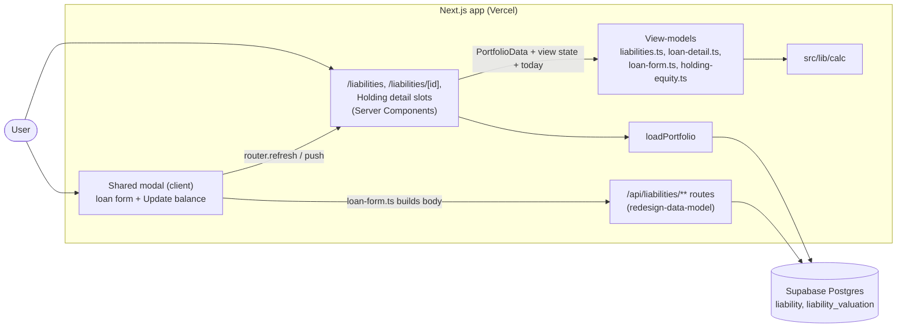

# Design

## Context

See proposal.md (Why). The decisions come from the closed wayfinder map [#13](https://github.com/adarsh645-git/finasset-360/issues/13), mainly [Liabilities as loans #3](https://github.com/adarsh645-git/finasset-360/issues/3), with [#4](https://github.com/adarsh645-git/finasset-360/issues/4) (balances as recorded, interpolated history), [#8](https://github.com/adarsh645-git/finasset-360/issues/8) (stale cues) and [#16](https://github.com/adarsh645-git/finasset-360/issues/16) (empty states, responsive, links). The screens follow the mockup README's screens 6, 7 and 10 and the prototype's `li`, `lo`, `openEditLoan()` and the liability branch of `save()`.

By the time this change starts, the earlier changes have landed:
- `src/lib/calc/` does the math: amortization, payoff, interest remaining, Not on track, interpolation, the 12-month set rule, Equity and staleness.
- `redesign-data-model` provides `loadPortfolio` and the Liability write routes. Its rules include principal stored as max(principal, balance), today's Valuation upserted on every save, one active loan per Holding (DM-28…DM-33), and unlinking a Holding's loans when it is archived.
- `redesign-shell-and-overview` provides the `(app)` layout, the link registry (`src/lib/views/links.ts`: `EXISTING_ROUTES`, `hrefFor`, `ADDING`), `RowLink`, the chart primitive (date x-axis, stacked bases, projection trimmed by the projection context), the `@container` two-column class and `src/lib/format/` (FM-01…FM-10).
- `redesign-holding-entry` provides the modal shell (URL-driven, bottom sheet on phone, footer error line), Holding detail with slots for equity, and the two-click Delete pattern.

Governing ADRs: 0004 (archive, not delete), 0007 (Liabilities are amortizing loans), 0008 (dated Valuations, FX by date).

## Goals / Non-Goals

**Goals:**
- Every number on these screens comes from `src/lib/calc/` through one pure view-model per screen. Pages only render what the view-models return.
- Add, edit, update and archive a loan with the existing routes, then `router.refresh()`.

**Non-Goals:**
- New routes, schema or read-model fields. If a gap shows up, it goes back to `redesign-data-model` (none known).
- Range controls on these pages. The mockup has none. The payoff timeline shows all history.

## Architecture

- **Reads:** the page gets `PortfolioData` from the `(app)` layout's request-scoped loader, then calls its view-model with today and the view state. The view-model returns rows, labels, chart series and `href | null` values.
- **Writes:** the client modal turns form state into a request body with `loan-form.ts`, sends it with `fetch`, then refreshes (edit, update) or navigates (add to the new Loan detail, archive to `/liabilities`).

## Decisions

### D1. Liabilities are flat loans with required terms; "loan" in the UI
The form asks for name, Country, balance, principal, APR, Monthly payment, start month, optional term, optional linked Holding and revolving. There is no Liability Class. "Loan" is the word for one Liability on screen ("Add loan", "Edit loan"); "Liabilities" names the section. ([#3](https://github.com/adarsh645-git/finasset-360/issues/3), ADR 0007)
- *Alternatives:* keeping Liability Classes or optional amortization, rejected in #3.

### D2. "Revolving" changes labels only
The "Credit card (revolving)" checkbox is off by default. It switches "Fixed APR" to "Revolving credit" and "EMI" to "Your planned payment". The math is the same. ([#3](https://github.com/adarsh645-git/finasset-360/issues/3))
- *Alternative:* credit limits or utilisation, out of scope in #3.

### D3. The prototype's validation, plus a principal default
The four messages and their order are the prototype's `save()` (LE-03). Numbers have `,`, spaces, `$` and `₹` stripped. A blank principal saves as the balance, and a lower one as the balance (LE-04), the same rule data-model enforces. A blank term is no term. The route's own error, if any, shows in the same footer line. ([#3](https://github.com/adarsh645-git/finasset-360/issues/3))
- *Alternative:* reject a principal below the balance. Rejected: the prototype silently takes the larger, and a revolving card's "principal" is meaningless anyway.

### D4. "Borrowed in" is a month field, defaulting to this month
A month input with no later month allowed. The prototype stamps `start: NOW`, which would mislabel a 2019 mortgage. ([#3](https://github.com/adarsh645-git/finasset-360/issues/3))

### D5. The Monthly payment includes extras and excludes escrow
The field carries the hint in LE-02. There is no separate extra-payment or escrow field. ([#3](https://github.com/adarsh645-git/finasset-360/issues/3))

### D6. Balances are recorded, never amortized forward; every save logs today
Today's balance is the latest Valuation. History is interpolated (calc D7), and only the future is amortized. Add, Edit and Update balance all record today's Valuation, even when unchanged, which is how a loan stops being Stale. No history is back-filled from the start month. ([#3](https://github.com/adarsh645-git/finasset-360/issues/3), [#4](https://github.com/adarsh645-git/finasset-360/issues/4), [#8](https://github.com/adarsh645-git/finasset-360/issues/8))
- *Alternative:* derive past balances from the amortization schedule, rejected in #3 as made-up numbers.

### D7. "Paid down in 12 mo" uses the like-for-like set rule
The header uses calc's set change over Liabilities (NH-10): only loans with a Valuation a year ago count. With none, it reads "—" (LB-02). This supersedes #3's "a new loan shows 0" (calc D9). An archived loan that existed a year ago counts as paid down to 0, which matches Net Worth history.
- *Alternative:* the prototype's naive total difference. Rejected: adding a loan would show as negative paid down.

### D8. Stats count only loans with a positive balance; Not on track is explicit
- **Monthly payments:** the sum of payments of loans with balance > 0, in USD at today's rate. A paid-off loan's payment no longer counts.
- **Weighted rate:** APR weighted by USD balance.
- **Debt-free:** the latest payoff month across loans, with sub "In ⟨duration⟩ at current payments". It reads "Not on track" if any loan is Not on track.
- **Interest remaining:** the sum over on-track loans. When some are Not on track, the sub says "Excludes N loan(s) not on track" (LB-05), because calc reports no interest for them (calc D4).
- *Alternative:* the prototype's sum of partial interest over 720 months. Rejected: calc returns none, and the number would be meaningless.

The duration comes from FM-09 ("in 6.2 yrs"), capitalised at the start of a sub.

### D9. Loan detail's Not on track and zero-balance states
Not on track: "Never" / "—" / "Payment doesn’t cover interest". Balance 0: "Paid off" / "Balance is 0" / 0 interest (LD-05). The prototype shows its partial-interest number and "In 1 mo" for these, which are artefacts.

### D10. Loan colours: five tokens, assigned by creation order
`--loan-1` … `--loan-5` are the prototype's `LOAN_COLORS`, added as `@theme` tokens. They are assigned by creation order over all the User's loans, including archived ones, and cycle after five. So a loan keeps its colour when balances reorder the rows. Rows are sorted by USD balance, largest first, and the timeline stacks in the same order, largest at the bottom.
- *Alternative:* colour by row position, as the prototype does. Rejected: colours would swap when balances cross.

### D11. The payoff timeline includes archived loans for the dates they were held
It stacks every Liability's interpolated USD balance at the shared sample dates (from the first Liability Valuation) then the projected balance to the horizon. That way the stack's top always equals the Liabilities total that Overview and Growth use (LB-10, LB-11). The tooltip shows each loan's own balance. The view-model returns all points, and the chart trims them when the projection is off.
- *Alternative:* active loans only. Rejected: paying off a loan and archiving it would erase its history from the chart.

### D12. Loan detail chart window
From the loan's first Valuation to six months after payoff, capped at the horizon's end. A Not on track loan runs to the horizon's end. The linked Holding's value is a second line, and the y-axis starts at 0 (LD-06). A brand-new loan has one point, then the projection ([#16](https://github.com/adarsh645-git/finasset-360/issues/16) empty states).

### D13. One active loan per Holding; the picker hides taken Holdings
Linked asset lists "None" plus the User's active Holdings that no other active loan links to, plus the loan's own Holding when editing (LE-06). This mirrors data-model's DM-32, so a valid choice never fails at save. Archiving a Holding unlinks its loans (data-model), so the loan then shows no "Secures" or "Secured against". ([#3](https://github.com/adarsh645-git/finasset-360/issues/3))
- *Alternative:* several loans per Holding (a mortgage plus a HELOC). Rejected for now: Equity per pair would double-count the value, and the mockup finds one loan per Holding.

### D14. Held in is fixed when editing (data-model: Country fixed after creation)
The Country chips are shown but disabled in Edit loan. Valuations are stored in native currency, so changing the Country would reinterpret every past balance. This matches DM-17 for Holdings. The prototype allows it, but there it carries no history.

### D15. Modal modes and URL state
- **Add:** `?modal=add-liability`. The Asset | Liability toggle swaps `add-asset` ↔ `add-liability` with `router.replace`, so Back still closes the modal. Name and Held in carry over (LE-01).
- **Edit:** `?modal=edit&liability=<id>`, titled "Edit loan".
- **Update balance:** `?modal=update&liability=<id>`, with one input and "Was … · logged as today’s value, ⟨Mon D, YYYY⟩" (LE-08). `redesign-update-pass` adds "Save & next" to this mode.
- After a save: add pushes `/liabilities/<new id>`; edit and update close the modal and refresh.
- **Routes** (data-model's contract table): add → `POST /api/liabilities` (`country`, `name`, `balance`, `principal?`, `apr`, `monthly_payment`, `term_years?`, `start_month?` as `YYYY-MM`, `revolving?`, `linked_holding_id?`); edit → `PATCH /api/liabilities/[id]` (full replacement, same `country`); Update balance → `POST /api/liabilities/[id]/valuations` (`balance`); Delete → `POST /api/liabilities/[id]/archive`. APR is sent as entered, in percent. There is no permanent-delete route. The view-models read `PortfolioData.liabilities` (`principal`, `apr`, `monthlyPayment`, `termYears`, start month, `revolving`, linked Holding, archive date, balance Valuations).

### D16. Loan detail actions mirror Holding detail
The actions are Update balance (primary), Edit, and Delete (click twice: "Confirm delete", reset on navigation). The scope adds Edit next to the prototype's two buttons, because #8 names "Edit" as a loan's fix path, and Update balance is the quick path. Delete archives (ADR 0004) and goes to `/liabilities`. There is no "Delete permanently". ([#8](https://github.com/adarsh645-git/finasset-360/issues/8), [#13](https://github.com/adarsh645-git/finasset-360/issues/13) notes)

### D17. Stale cue for loans
calc staleness on the latest balance Valuation. A row's meta line ends with "· ⟨FM-10 age⟩" ("· 47 days old"), and Loan detail's native line ends with "· updated N days ago" (the same shape holding-entry uses for Holdings). Rows are not dimmed. ([#8](https://github.com/adarsh645-git/finasset-360/issues/8))

### D18. Equity on Holding detail lives in this change's view-model
`holding-equity.ts` takes `PortfolioData`, the Holding id and today. It returns `null` when no active loan links to the Holding. Otherwise it returns the Linked loan card, the "Your equity" stat (appended last) and the replacement chart series ("Value" shaded to "Loan balance", Equity in the tooltip, zero-based). Holding detail renders it in the slots holding-entry left. The math is calc's Equity (EQ-01…EQ-04). ([#2](https://github.com/adarsh645-git/finasset-360/issues/2))
- *Alternative:* edit `holding-detail.ts` directly. Rejected: it would mix two changes' scenarios in one view-model.

### D19. Links and add buttons through the shell's registry
The first ticket adds `liabilities` and `liability(id)` to `EXISTING_ROUTES` and turns on the "or a loan" add link (`?modal=add-liability`) in `links.ts`. That alone turns on the nav item (sidebar, tablet tabs, phone tab bar), the Overview Liabilities stat card, and the "Needs updating" loan rows (LB-13). No other mechanism. (Brief addendum; [#16](https://github.com/adarsh645-git/finasset-360/issues/16) "What shippable means")

### D20. Empty state
With no active loan: a $0 total, "—" paid down, "—" for every stat value, no chart, and "No loans" + "Add loan" in place of the rows (LB-12). This also covers a User whose loans are all archived. ([#16](https://github.com/adarsh645-git/finasset-360/issues/16))

### D21. Responsive behaviour
- **Stats:** `repeat(auto-fit, minmax(180px, 1fr))`, so 4 → 2 → 1 columns.
- **Rows:** on phone (<640px), loan rows drop the native amount and the Country badge, and the meta lines wrap.
- **Loan detail:** the actions wrap under the balance. The Secured against card and charts go full width, using the shell's `@container` two-column class where two cards sit side by side.
- **Loan form:** a grid of `minmax(200px, 1fr)`, one column in the phone bottom sheet. Inputs are 16px on phone, and buttons, selects and the checkbox row are at least 40px tall.
- **Charts** follow the primitive's phone rules.
- All of this is checked by hand at 2000px, 800px and 390px. ([#16](https://github.com/adarsh645-git/finasset-360/issues/16) responsive)

## Testing Decisions

**Seams (confirmed with the user):**
1. **Screen view-models:** pure `(PortfolioData, viewState, today) → view` functions, tested in Vitest under `tests/unit/` with hand-built `PortfolioData`. Assertions are on what the screen shows: labels, values, order, which cards exist, and `href` or null.
2. **Server render** with `renderToStaticMarkup` where a scenario is about markup: the toggle's presence, disabled Held in, the empty state, and which cards are absent.

The calculations module is the third seam and is already tested by `redesign-calculations`. These tests use its outputs as oracles, never reimplement them. The route boundary is `redesign-data-model`'s, and this change adds no route tests. There is no Playwright or jsdom. Layout, responsive behaviour, hover and touch are checked by hand by the user at ~2000px, ~800px and ~390px.

| Scenarios | Test file (`tests/unit/`) | Seam |
|---|---|---|
| LB-01 … LB-12 | `liabilities-view.test.ts` | `liabilities.ts` view-model |
| LB-13 | `liabilities-links.test.ts` | shell and Overview view-models through `links.ts` |
| LD-01 … LD-09, LD-11 | `loan-detail-view.test.ts` | `loan-detail.ts` view-model (null → not found) |
| LD-10 | `loan-detail-delete.test.tsx` | `renderToStaticMarkup` of the actions + `loan-form.ts` archive request + `liabilities.ts` after archive |
| LD-12 … LD-14 | `holding-equity-view.test.ts` | `holding-equity.ts` view-model |
| LE-01, LE-02, LE-07 (form state) | `loan-form-render.test.tsx` | `renderToStaticMarkup` of the loan form |
| LE-03 … LE-06, LE-08, LE-09 | `loan-form.test.ts` | `loan-form.ts` (initial state, validation, request body, options, next URL) + view-models for the after-save screen |

Each test name starts with its scenario ID. "After save" outcomes (LE-05, LE-07, LE-08) are proved by feeding the view-model the `PortfolioData` that data-model's route contract produces (a Valuation dated today). Data-model's DM-28…DM-31 already prove the routes write it.

**Prior art:** `tests/unit/cash-holding-form.test.tsx` and `empty-portfolio-render.test.tsx` (server render), plus the shell-and-overview view-model tests.

## Risks / Trade-offs

- [holding-entry's slots or Delete pattern land with a different shape] → D18 keeps the equity logic in its own view-model, so only the rendering glue adapts.
- [An archived loan counts as "paid down" in 12 mo] → It matches Net Worth history (calc D7/D9). Restoring archived items is out of scope.
- [A Not on track loan dominates the timeline as it grows] → It's the honest picture, and the Debt-free stat explains it.
- [Five colours cycle after five loans] → Rows also carry names, and the tooltip names each layer.
- [The User reviews at 2000px while agents check at ~1288px] → Hand checks are the user's, at the three named widths.

## Migration Plan

UI only: no migration and no production `db push`. It deploys with the merge. Rollback reverts the commit. With the routes removed from `EXISTING_ROUTES`, every incoming link falls back to plain text.
