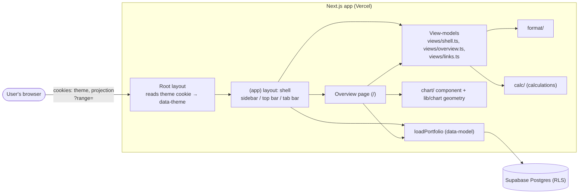

# Design

## Context

See proposal.md (Why) for motivation. The decisions come from the closed wayfinder map [#13](https://github.com/adarsh645-git/finasset-360/issues/13): its Notes (tokens, cookie theme, real routes, one hand-rolled SVG chart, sign-in chrome re-homed), and the tickets [#2](https://github.com/adarsh645-git/finasset-360/issues/2), [#8](https://github.com/adarsh645-git/finasset-360/issues/8) and [#16](https://github.com/adarsh645-git/finasset-360/issues/16). The mockup is the authority: the README's Shell, Overview, Responsive behaviour and Design tokens sections, and `Portfolio Tracker.dc.html` (shell and Overview markup on lines 24–160, `Chart()` on lines 920–990, and `renderVals()`).

State when this change starts, after `redesign-data-model`:
- `/` is a signed-in "Being rebuilt" page.
- `loadPortfolio(supabase, today) → PortfolioData` exists under RLS.
- `src/lib/calc/` provides history, FX by date, 12-month change, attribution, Equity and staleness.
- CI runs the Vitest unit and route suites.
- `src/app/globals.css` still carries the old near-monochrome palette, with `prefers-color-scheme` dark and an Arial body.
- `SignOutButton` and `firstNameOrEmail` survive the cutover.

Next.js 16.3: the root layout can read `cookies()`, which makes it dynamic. Every signed-in page is dynamic anyway, because it reads the session.

## Goals / Non-Goals

**Goals:**
- One shell, one chart, one set of formatters and one link registry that changes 4–9 only feed. They never fork them.
- Every number on the Overview comes from `src/lib/calc/` through a pure view-model. The page only renders what the view-model returns.
- The server renders the right theme and the right layout for every width with no flash and no client-side measuring.

**Non-Goals:**
- Visual regression or browser automation. Layout is checked by hand at named widths.
- Caching `loadPortfolio` across requests.
- Error and loading pages beyond Next's defaults.

## Architecture

- **Data flow:** the `(app)` layout and the page each call one request-scoped `getPortfolio()`, which wraps `loadPortfolio` in React `cache()`, so the read model runs once per request. They pass `PortfolioData`, view state (pathname, range, projection) and today to the pure view-models, then render what comes back.
- **Client components:** only the theme toggle, the projection toggle (with its context), the chart and Sign out. Everything else is a Server Component.

## Decisions

### D1. Tokens as CSS variables exposed through `@theme inline`
`globals.css` defines the README tokens as variables on `:root` and overrides them under `[data-theme="dark"]`:
- the base colours: bg, panel, ink, ink2, ink3, line, line2, hover, sel, pos, neg and shadow;
- the six class colours and the two Country colours;
- radii (card 14, inner 10–12, button 9, chip 999), and the type scale as utilities.

`@theme inline` maps them to Tailwind names (`bg-panel`, `text-ink2`, `border-line`, `bg-cls-stocks`, `bg-country-in`…). The `dark:` variant is redefined as `@custom-variant dark (&:where([data-theme=dark], [data-theme=dark] *))`. The body uses Geist with `tabular-nums`, replacing Arial. A small `src/lib/tokens.ts` maps class and Country ids to their variable names for SVG fills. ([#13](https://github.com/adarsh645-git/finasset-360/issues/13) Notes, [#2](https://github.com/adarsh645-git/finasset-360/issues/2) colour dots)
- *Alternatives:* keep `prefers-color-scheme` (rejected: the map settled on a persisted toggle); hard-code oklch values in components (rejected: there would be no single source, and dark mode would need duplicates).

### D2. The theme is a cookie read on the server; light by default
The root layout reads cookie `theme`. `dark` gives `data-theme="dark"` on `<html>`; anything else, or no cookie, gives light. The toggle is a client button. It sets `document.documentElement.dataset.theme`, writes `theme=<v>; Path=/; Max-Age=31536000; SameSite=Lax`, and updates its own label. There is no server round trip and no `router.refresh()`. The pure helpers `resolveTheme(cookie)` and `nextTheme(current)` and the cookie string are unit-tested (TH-01, TH-02), and `<html data-theme>` is checked with a static render of the root `Document` component. ([#13](https://github.com/adarsh645-git/finasset-360/issues/13) Notes)
- *Alternatives:* `localStorage` with an inline script (rejected: the map says cookie, and the server would render the wrong label); follow the OS when there's no cookie (rejected: the server can't know it without a flash; the mockup defaults to light).

### D3. A route group owns the shell; the login page stays outside
`src/app/(app)/layout.tsx` checks the session (redirecting to `/login` if there is none), loads the Portfolio and renders the shell. `(app)/page.tsx` is the Overview and replaces the interim page. Later pages (`/assets`, `/holdings/[id]`…) go in the same group. `/login` and `/auth/*` stay outside it.
- *Alternative:* the shell in the root layout with a per-path opt-out. Rejected: the login page would carry branching.

### D4. Three nav forms in the markup, switched by CSS breakpoints
The server renders the sidebar, the top bar with tablet tabs, and the phone tab bar. Tailwind breakpoints show one: sidebar at `lg` (1024px), tablet tabs at `sm`–`lg` (640–1023px), and the bottom bar below `sm`. The bottom bar is `fixed` with `padding-bottom: env(safe-area-inset-bottom)`, and phone pages end with 76px of spacing. All three render from one `buildShell()` result, so they can't disagree (SH-02). Nothing measures `window.innerWidth`, unlike the prototype's `_rs`. ([#16](https://github.com/adarsh645-git/finasset-360/issues/16) responsive)
- *Alternative:* measure on the client and render one form. Rejected: it flashes and is wrong on the server render.

### D5. The 820px stacking rule is a container query on the content column
The column beside the sidebar is an `@container`. Two-column sections use `@min-[820px]:grid-cols-[minmax(0,1.45fr)_minmax(0,1fr)]`. That matches the prototype's "viewport minus sidebar ≥ 820" exactly at every breakpoint, and later pages (Growth, detail) reuse the same class. Touch targets are global CSS: `@media (pointer: coarse), (max-width: 639px) { button:not([data-tile]), select { min-height: 40px } }`, plus 16px inputs below 640px.

### D6. The phone chart rules are CSS, not geometry
The geometry is computed once in a fixed 1000 × H viewBox, with `preserveAspectRatio="none"` and non-scaling strokes. Axis labels, dots and the tooltip are positioned in percentages of the plot. So the phone height (`round(H × 0.78)`, set with `max-sm:` height classes), the 36px y-axis and the hidden end labels are pure CSS, and the server render is right at every width. The phone height is computed by the geometry helper and passed as a CSS variable (CH-14). ([#13](https://github.com/adarsh645-git/finasset-360/issues/13) Notes)
- *Alternative:* a `matchMedia` hook. Rejected: it causes a layout shift on phones.

### D7. The chart is split into pure geometry and a thin client component
`src/lib/chart/` holds the pure functions:
- `niceTicks`, the y-domain from scaled series, bases, goals and the optional forced zero (CH-01–CH-03, CH-08, CH-16);
- tooltip and end-label values from a series' `tip` when given, otherwise its drawn values (CH-15);
- x-scale by time (epoch days), so irregular samples (month-ends plus today) and monthly projections share one axis;
- the x labels (CH-09) and paths split at today into solid and dashed (CH-05/06);
- area paths with bases (CH-04), end-label collision (CH-10) and the nearest point for a pointer fraction (CH-12).

`src/components/chart/Chart.tsx` takes the following and renders SVG plus HTML labels, the crosshair, the tooltip and touch handling:
- `series[]`: `{ name, points: {date, value}[], color, line?, area?, base?, tip?: {date, value}[], dot?, bold?, endLabel?, scaled? }`. `tip` gives the values a stacked layer shows in its tooltip row and end label, while it is drawn at `points` (the prototype's `s.tip`; CH-15). Liabilities (payoff timeline) and Growth (By asset class) use it;
- `today`, `height`, `projection`, `zero?` (force $0 into the y-range, the prototype's `p.zero`; CH-16, used by Loan detail, Value vs. loan and Growth), `goals[]` and a `legend` node.

Touch: `onTouchStart`/`onTouchMove` select a point, and `onTouchEnd` clears it after 1,800ms through an injectable timer (CH-13, tested with Vitest fake timers on the component's reducer); the plot has `touch-action: pan-y`. The prototype's month-index model is dropped in favour of dates. ([#13](https://github.com/adarsh645-git/finasset-360/issues/13) Notes: "one shared hand-rolled SVG primitive")
- *Alternative:* a chart library. Rejected by the map.

### D8. The projection toggle is a cookie plus a client context, and the range is a search param
Cookie `projection` (`on`|`off`, default on) is read by the `(app)` layout and seeds a `ProjectionProvider`. The toggle flips the context at once and writes the cookie, and every `Chart` reads the context. View-models always return projected points, and the chart trims them when the projection is off (CH-06, CH-07). The range is `?range=1Y|3Y|5Y|All` (default All, unknown → All), set by `<Link replace scroll={false}>` segments (OV-04). The prototype's default range is All. (Brief's shared conventions; [#5](https://github.com/adarsh645-git/finasset-360/issues/5): the toggle is view state.)
- *Alternative:* a cookie with `router.refresh()`. Rejected: it re-runs the read model just to hide a dashed line.

### D9. One link registry decides link versus plain text
`src/lib/views/links.ts` exports `EXISTING_ROUTES` and `hrefFor(target)`, where target is one of `overview | assets | assetClass(id) | holding(id) | liabilities | liability(id) | growth | goals`. It returns the path when that route family is in the set, otherwise `null`. View-models put `href: string | null` on every row, and one `<RowLink>` renders an `<a>` or a plain element. In this change the set is `{ overview }`. Each later change adds its own family in its first ticket. That is how asset-pages turns on the class rows, Allocation rows and the Assets nav, holding-entry turns on the Holding detail rows, and so on (SH-08, SH-09, OV-08, OV-10, OV-19). ([#16](https://github.com/adarsh645-git/finasset-360/issues/16) "What shippable means")
- *Alternatives:* each change edits every call site (rejected: links get missed); a filesystem check at runtime (rejected: too clever, and not unit-testable).

### D10. "+ Add" is hidden until holding-entry; the first-run card has no button
The sidebar's "+ Add account or asset", the top bar's "+ Add", the first-run card's Add button and its "or a loan" link render only when an `ADDING` flag in `links.ts` is on. The flag is off here, `redesign-holding-entry` turns on the asset add (`?modal=add-asset`), and `redesign-liabilities` turns on "or a loan" (`?modal=add-liability`). Until then the first-run card shows its title and the explainer "Your net worth, allocation and projection appear here once you've added something." Data goes in with `npm run seed` locally. (Brief: order and interim states)
- *Alternatives:* a disabled button (rejected: it looks broken); a "coming soon" note (rejected: it's copy that would ship and then be deleted).

### D11. Sign-in chrome goes to the sidebar footer and the top bar
The sidebar footer, below the theme toggle, shows the first name (`firstNameOrEmail`) and the existing `SignOutButton`, restyled with tokens. The tablet top bar shows the name and Sign out. The phone top bar shows Sign out only, beside Dark/Light. ([#13](https://github.com/adarsh645-git/finasset-360/issues/13) Notes: re-homed)
- *Alternative:* an account popover. Rejected: it's more UI than two items need.

### D12. The brand is "FinAsset 360" with the mockup's mark
The prototype's "Holdings" is a placeholder, and "Holding" is a domain term (CONTEXT.md), so the brand stays the app's name. The mockup's two-bar logo mark is kept.

### D13. The shell view-model
`buildShell(data, { pathname }, today)` returns:
- Net Worth with its 12-month change (absent → "—"; SH-05);
- the five nav items with label, compact value (Assets and Liabilities only; Goals' count is left to `redesign-goals`), `href` and the active flag (SH-03);
- the class list in the fixed order, current Holdings only (SH-07);
- the user's display name.

Current figures exclude archived items (ADR 0004, SH-06). Net Worth's 12-month change is a plain difference ([calculations](../redesign-calculations/design.md) D9). It is "—" when the Portfolio's earliest Valuation is after 12 months ago, consistent with "never +100%" ([#16](https://github.com/adarsh645-git/finasset-360/issues/16)).

### D14. The Overview view-model and its card rules
`buildOverview(data, { range }, today)` returns `{ firstRun, header, chart, stats, allocation | null, equity | null, countries, currencyEffect | null, needsUpdating | null }`. All of its math is calls into `calc/`:
- **First run:** no current Holdings and no current Liabilities, even if archived ones exist (OV-21, OV-22). Only the header label and $0 are returned. ([#16](https://github.com/adarsh645-git/finasset-360/issues/16))
- **Header:** the range start is clamped to the earliest Valuation (calc NH-04). The percent shows only when Net Worth at the start is above 0 (the prototype's rule, OV-03).
- **Stats:** the set 12-month rule (calc D9). An absent figure reads "— in 12 mo". With no loans the card reads "No loans", and with no links "No loans linked to assets". Singular "1 account or asset" (OV-07). Targets: `/assets`, `/liabilities`, `/growth` (Equity built goes to Growth, as in the prototype) through `hrefFor`.
- **Allocation:** classes with current Holdings, sorted by value, descending. The share of total assets is 0% when the total is 0. The 12-month change uses the set rule. The card is absent with no Holdings.
- **Equity:** pairs where both sides are current. % owned comes from calc (clamped). Rows target `holding(id)`.
- **Where it's held:** Countries with a current item, in the order US then India.
- **Currency effect:** present when any current item is in India. The amount is calc attribution's Currency effect for t0 = today − 12 months. The note gives the FX then and now to two decimals, plus "as of D Mon" when today's rate is older than today (OV-15). The prototype's fixed sentence about which side lost value is dropped: it's only true in one direction.
- **Needs updating:** calc staleness over current Holdings and Liabilities. Stocks rows say "prices N days old". Sorted by age, descending, then by name. No cap: the monthly pass is 10–30 items ([#8](https://github.com/adarsh645-git/finasset-360/issues/8)). The title carries the count. The ordered list is built by `buildStaleList(data, today)` in `src/lib/views/stale-list.ts`, exported on its own. It returns one row per Stale item (kind, id, name, age, Stocks or not, `href`), sorted by age then name, and `buildOverview` calls it, so `redesign-update-pass` reuses the same order without calling `buildOverview`. The card's header has an empty trailing action slot to the right of the title, which update-pass fills with "Update all (N)". It renders nothing in this change. Rows target `holding(id)` or `liability(id)`. Position: right column, above the Goals slot ([#8](https://github.com/adarsh645-git/finasset-360/issues/8)).
- **Goals slot:** an empty named region in the right column, and the chart's `goals` prop is `[]`. `redesign-goals` fills both under its own capability.

### D15. Formatting helpers are one small module of pure functions
`src/lib/format/` exports `usd`, `inr`, `native(v, country)`, `compact`, `signed`, `signedCompact`, `signedPct`, `share(part, total)`, `monthLong`, `monthAxis`, `inDuration(months)`, `daysOld(n)` and `DASH`. Every helper accepts `null` for an absent figure and returns "—" (FM-07). The minus sign is U+2212, and `−$0` collapses to `$0`. The compact thresholds follow the prototype's `cmp()` exactly (FM-04).
- *Alternative:* `Intl.NumberFormat` compact notation. Rejected: it gives "$1.3M" and "$412K" with different rounding from the mockup.

### D16. The Needs updating rows, equity rows and stat cards render with the same `RowLink`
Hover backgrounds apply only to links, so plain-text rows don't look clickable before their page exists.

## Testing Decisions

**Seams (confirmed with the user):** the screen view-models and pure helpers in Vitest (seam 3), with `renderToStaticMarkup` for markup scenarios. There are no route tests: this change adds no routes, and RLS is covered by data-model's read-model tests. There is no Playwright or jsdom. Tests build `PortfolioData` fixtures by hand and inject today. They assert what the screen shows (labels, order, presence, link targets), never component internals.

| Scenarios | Test file (`tests/unit/`) | Seam |
|---|---|---|
| FM-01 … FM-10 | `format.test.ts` | format helpers |
| CH-01 … CH-12, CH-15, CH-16 | `chart-geometry.test.ts` | `src/lib/chart` pure geometry |
| CH-13, CH-14 | `chart-render.test.tsx` | Chart component: touch reducer with fake timers; static markup |
| TH-01 … TH-03 | `theme.test.tsx` | `resolveTheme`/`nextTheme`/cookie string, `Document` static render, tokens map |
| SH-01 | `app-layout.test.tsx` | `(app)` layout's session guard with a stubbed Supabase client and `redirect` mock |
| SH-02 … SH-11 | `shell-view.test.ts`, `shell-render.test.tsx` | `buildShell`; static render for SH-02, SH-08, SH-10, SH-11 |
| OV-01 … OV-23 | `overview-view.test.ts`, `overview-render.test.tsx` | `buildOverview`; static render for OV-08, OV-10, OV-12, OV-16, OV-18, OV-20, OV-21, OV-23 |

Each test name starts with its scenario ID, and `npm run spec:coverage` gates them.

**By hand (the user, against the mockup):** the sidebar, tablet tabs and phone tab bar at 2000px, 800px and 390px; two-column stacking around 820px of content; 40px targets; the theme with no flash on reload; chart hover, crosshair and touch on a phone; the projection toggle across charts. Every hand check names its width.

**Prior art:** `tests/unit/empty-portfolio-render.test.tsx` and `cash-holding-form.test.tsx` (static renders with a mocked `next/navigation`), and `net-worth.test.ts` for hand-built fixtures.

## Risks / Trade-offs

- [Rendering three nav forms costs a little extra markup] → It's tiny (five items each), and it buys a correct server render at every width.
- [The link registry is a global set that later changes must remember to update] → Each owning change's first ticket flips it, with tests named by its own scenario IDs. SH-09 proves the mechanism.
- [`cookies()` in the root layout makes the login page dynamic] → It's already dynamic (it reads the session). No static pages are lost.
- [Charts get series from the view-models, not the calc module] → Pages stay thin, and the view-models are the only place series are built.
- [`loadPortfolio` is called from both the layout and the page] → The React `cache()` wrapper dedupes it per request.
- [Equity built links to Growth, which won't exist until change 8] → It stays plain text until then (D9).
- [The first-run card has no action until holding-entry] → Production already can't add data between data-model and holding-entry ([#16](https://github.com/adarsh645-git/finasset-360/issues/16) notes), and the card ships finished when the flag flips.

## Migration Plan

No schema or data. Deploying replaces the interim "Being rebuilt" page with the Overview. Rollback means reverting the merge, which brings the interim page back. There are no Vercel environment changes.

## Open Questions

None that change the specs or the tickets. The explainer copy on the first-run card can be adjusted during review.
