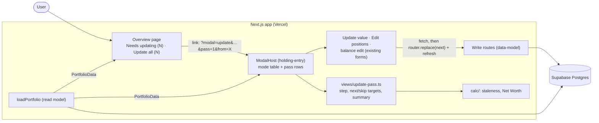

# Design

## Context

See proposal.md (Why) for motivation. The decisions come from the closed wayfinder map [#13](https://github.com/adarsh645-git/finasset-360/issues/13): mainly [#20](https://github.com/adarsh645-git/finasset-360/issues/20) (the guided pass, option 2), with [#8](https://github.com/adarsh645-git/finasset-360/issues/8) for the staleness rules and [#16](https://github.com/adarsh645-git/finasset-360/issues/16) for placement. The mockup has no pass. Its Update value modal ("Was ⟨old⟩ · logged as today's value") is the base.

This change only adds to seams that earlier changes left for it:
- **`redesign-holding-entry` D19:**
  - a `ModalHost` in the `(app)` layout that resolves `modal` params through a mode table;
  - a dialog frame with a footer slot reserved for "Save & next" and "i of N";
  - Update value (`?modal=update&holding=<id>`) and Edit positions (the same params on a Stocks Holding, with the title "Edit positions").
- **`redesign-liabilities`:** the balance edit `?modal=update&liability=<id>` (LE-08), which "redesign-update-pass adds Save & next to".
- **`redesign-shell-and-overview`:** `buildOverview(...).needsUpdating`, titled "Needs updating (N)". It holds calc staleness over current Holdings and Liabilities, oldest first, then by name.
- **`redesign-data-model`:**
  - `POST /api/holdings/[id]/valuations` and `POST /api/liabilities/[id]/valuations` upsert today's Valuation, even for an unchanged value.
  - `PATCH /api/holdings/[id]` for Stocks replaces the Positions. It re-dates a Hand Price only when its price changes, unless the request carries `confirm_prices: true` (data-model D6).
  - Each Valuation's `source` lets staleness use only user-entered dates.

## Goals / Non-Goals

**Goals:**
- One pure view-model decides everything the pass shows: the step, counter, next and skip targets, and the summary lines. Every scenario is proven there, in server-rendered markup, or at the route seam.
- No new route, table, API or stored state. The URL is the pass's only memory.

**Non-Goals:**
- Changing the forms themselves (fields, validation, the positions editor). Those stay as holding-entry and liabilities built them.
- Handling a stale item with nothing to confirm, e.g. a Stocks Holding whose stale Hand Price the User can't check. Skip covers that.

## Architecture

- **Boundary:** the view-model is pure, with signature `(PortfolioData, { current, i, from }, today) → view`. The client part only saves, then navigates to the target the view-model already worked out.
- **Data flow:** the layout's `PortfolioData` from *before* a save gives the next target. After `router.refresh()` the next step is computed again from fresh data.

## Decisions

### D1. A light pass on the existing modal, opened from the Needs updating card
"Update all (N)" sits on the Needs updating card, using the card's own count. Each step is the item's own update form with pass chrome in the footer slot: "Skip", "Save & next" and "i of N". There's no page, route, nav item or badge. ([#20](https://github.com/adarsh645-git/finasset-360/issues/20), [#8](https://github.com/adarsh645-git/finasset-360/issues/8))
- *Alternatives:* list only (option 1), about 4 clicks per item, rejected by the user. The old full Check-in (option 3), with a full-screen stepper, an "everything vs stale" choice and stored sessions, rejected because it needs a new surface the mockup lacks.

### D2. URL shape: modal params plus `pass` and `from`
- **A step:** the existing modal params plus `pass=<i>` (1-based) and `from=<whole USD>`, e.g. `/?modal=update&holding=<id>&pass=3&from=1284300`.
- **The summary:** a new mode-table row, `?modal=pass-summary&from=<whole USD>`.
- **`from`:** the Net Worth when the pass started, rounded to whole dollars. The Overview view-model writes it into the "Update all" link.
- **History:** opening the pass pushes one history entry, and each later step uses `router.replace`. So Back leaves the pass, as Esc does, instead of walking back into items already saved.
- **Bad params:** a missing or invalid `pass` (not a positive integer) opens the plain modal with no pass chrome. A missing `from` drops the arrow from the summary (UP-17).
- *Alternatives:*
  - Freezing the item list in the URL (`items=id,id,…`) or in sessionStorage. Rejected: 30 UUIDs make an unwieldy URL, sessionStorage breaks the URL-is-the-truth rule, and D4 doesn't need it.
  - Working out the starting Net Worth again from Valuations. Rejected: a same-day save outside the pass overwrites the earlier figure.
  - Pushing a history entry for each step. Rejected: Back would reopen an item already saved.

### D3. Order: the Needs updating card's order
The pass walks `needsUpdating`'s list exactly: oldest user-entered figure first, then by name (shell-and-overview's rule). This change doesn't sort again. It reuses that list builder, so the card and the pass can't disagree. Each item's form follows its kind: a manually valued Holding gets Update value, a Stocks Holding gets Edit positions, and a Liability gets the balance edit (UP-03). ([#20](https://github.com/adarsh645-git/finasset-360/issues/20))
- *Alternative:* group by kind (all loans, then all Holdings). Rejected: #20 says oldest first.

### D4. The list is live, with a cursor; it isn't frozen at the start
Each step reads the current Stale list L (D3 order). Let c be the current item's position in L.
- **Next** (after Save & next or Skip) is L[c+1], or the summary if there is none. It's computed from the data loaded *before* the save.
- **N** = (i − 1) + (|L| − c), counting the current item.
- **A saved item leaves L**, because today's Valuation makes it fresh. A skipped item stays in L but behind the cursor, so the walk never offers it again and never misses an item.
- **If the current item isn't in L** (updated elsewhere, or an old URL): next is L[0], and N = i + |L| (UP-13). That may offer a skipped item again, which is harmless.
- **Answer to "is the list fixed at the start?":** no, but in practice it behaves as if it were. N changes only when the data changes under the pass, e.g. an item updated in another tab (UP-12), or one turning Stale at midnight. A newly Stale item is the youngest, so it joins at the end.
- *Alternatives:*
  - Freezing the list at the start: see D2.
  - "Always the oldest Stale item, no Skip": the simplest rule, but rejected because a User who can't check a value would have to fake-confirm it, recording a false Valuation that clears Stale.
  - Keeping skipped IDs in the URL: rejected as unnecessary, since the cursor already handles them.

### D5. Save & next always records; Skip never does
- **Save & next** calls the form's normal save, the same route and body as outside the pass. An unchanged value still upserts today's Valuation, which clears Stale ([#8](https://github.com/adarsh645-git/finasset-360/issues/8), replacing SPEC story 42).
- **Stocks:** in a pass, Edit positions' save adds `confirm_prices: true` to `PATCH /api/holdings/[id]`. The server then dates every Hand Price today even when unchanged (redesign-data-model D6, DM-23/24/39/40), so the Holding clears (UP-14). Outside a pass the flag is never sent, and only changed prices are re-dated.
- **On error:** the footer error line shows the route's message and the step stays put (UP-07).
- **Skip** records nothing. The item stays Stale and on the card (UP-09).
- *Alternative:* a pass-only "confirm" endpoint that re-dates without resending. Rejected: it would be a second write path for the same fact.

### D6. Keyboard and focus
- Save & next is the form's submit button, so Enter confirms (UP-08). Skip is `type="button"`.
- On open, focus goes to the value input on Update value and the balance edit, with its text selected, so typing replaces it. On Edit positions, focus goes to Save & next.
- The positions editor keeps its own Enter-adds-a-row behaviour inside the new-position inputs (holding-entry). Enter elsewhere confirms the step.
- Esc, × and a backdrop click all leave the pass: they clear every modal and pass param. This is the dialog frame's existing close.
- The keyboard and focus behaviour is checked by hand. The markup test covers only which button submits.

### D7. Leaving keeps saves, and starting again is the resume
Leaving mid-pass shows no summary. Saves already made stay recorded, and Overview behind the modal has already refreshed. Items not reached, and items skipped, stay on the card, and "Update all (N)" starts a fresh pass over them (UP-11). No session is stored. ([#20](https://github.com/adarsh645-git/finasset-360/issues/20) out of scope)
- *Alternative:* show the summary on Esc. Rejected: Esc should simply leave, and the header Net Worth already shows the result.

### D8. The summary is computed, never stored
- **The Net Worth line:**
  - X = `from`. Y = today's Net Worth from `calc/` over fresh `PortfolioData`, rounded to whole dollars. Z = Y − X.
  - That gives "Net worth $X → $Y (+$Z)", with the money and signed-money formatting from `src/lib/format/` (FM-…).
  - Rounding Y before subtracting means the three figures always reconcile.
- **Still Stale:** a live count of Stale items, "N item(s) still need(s) updating", omitted at 0.
- **Actions:** one "Done" button, which is also the default action, so Enter closes. It clears the params.
- **Nothing written:** no table, cookie or storage holds the pass. ([#20](https://github.com/adarsh645-git/finasset-360/issues/20))
- *Alternative:* list each change made during the pass. Rejected: it would need a record of the pass, and #20 asks only for the Net Worth line.

### D9. Where the code lives
- **`src/lib/views/update-pass.ts`:**
  - `updateAllEntry(data, today)` returns `{ label, href } | null` for the card.
  - `passStep(data, { current, i, from }, today)` returns `{ title, counter, nextHref, skipHref }`.
  - `passSummary(data, { from }, today)` returns `{ netWorthLine, stillStale }`.
- **Overview:** the card renders `updateAllEntry` in its header. The card's markup belongs to shell-and-overview, and this change adds only the link.
- **ModalHost:**
  - It reads `pass` and `from` and passes `passStep` output into the footer slot.
  - It registers the `pass-summary` mode row.
  - The form components gain one callback, "after a successful save, go to `nextHref`". Outside a pass, they close as before.
- *Alternative:* a separate `PassHost`. Rejected: D19 already gives one host and a footer slot.

### D10. Responsive
On a phone the step is holding-entry's bottom sheet. The footer holds the counter on the left and Skip and Save & next on the right, each at least 40px tall. Below 390px the counter wraps above the buttons. At tablet and desktop widths the footer is a single row. Checked by hand at ~2000px, ~800px and ~390px. ([#16](https://github.com/adarsh645-git/finasset-360/issues/16) "Responsive behaviour ships inside each change")

## Testing Decisions

**Seams (confirmed with the user):** all three agreed seams, each driven through its public face with plain data and an injected today, asserting only what the User sees.
- **Screen view-model** (seam 3): `updateAllEntry`, `passStep` and `passSummary`. A "save" is simulated by passing the next `PortfolioData` with today's Valuation added. That's an oracle independent of the code.
- **Server render** (`renderToStaticMarkup`): the card's "Update all (N)" link and its absence (UP-01, UP-02), and that Save & next is the submit button while Skip isn't (UP-08).
- **Route boundary** against local Postgres (seam 2): saving an unchanged value, or unchanged Positions with and without `confirm_prices`, through the existing routes. `GET /api/portfolio` then shows the item fresh and the Hand Prices dated today only when confirmed (UP-05, UP-14). This guards the cross-change contract the pass depends on.
- **By hand:** Enter and Esc, focus, Back, the bottom sheet and the footer layout, at ~2000px, ~800px and ~390px. No Playwright, jsdom or Testing Library.

| Scenarios | Test file | Seam |
|---|---|---|
| UP-01, UP-02, UP-08 | `tests/unit/update-pass-render.test.tsx` | server render |
| UP-03, UP-04, UP-05, UP-06, UP-07, UP-09, UP-10, UP-11, UP-12, UP-13 | `tests/unit/update-pass-view.test.ts` | `passStep`, `updateAllEntry` |
| UP-15, UP-16, UP-17 | `tests/unit/update-pass-view.test.ts` | `passSummary` |
| UP-05, UP-14 | `tests/route/update-pass-confirm.test.ts` | write routes + `GET /api/portfolio` |
| UP-14 | `tests/unit/update-pass-view.test.ts` | Edit positions request builder: `confirm_prices` in a pass only |

UP-07 is checked at the view-model level: a rejected save leaves the data unchanged, so `passStep` returns the same step and counter. The error copy itself is holding-entry's (its validation scenarios). Each test name starts with its scenario ID, and `npm run spec:coverage` gates them.

**Prior art:** `tests/unit/cash-holding-form.test.tsx` and `empty-portfolio-render.test.tsx` (static render); `tests/route/*.test.ts` with `tests/fixtures/http.ts` (two Users, RLS on); holding-entry's and shell-and-overview's view-model tests.

## Risks / Trade-offs

- [The "Update all" link carries a `from` computed at render time. If data changes between render and click, X is slightly off] → It's display only, and the pass is a single sitting.
- [N can change mid-pass] → Only when the data changes under it (D4). The counter stays self-consistent: i never exceeds N.
- [Save & next on a Stocks step re-dates every Hand Price, including ones the User didn't really check] → Only in a pass, where confirming is the point. holding-entry's editor shows "price N days old" on each stale row before the User confirms.
- [A step URL names an archived or unknown item] → `ModalHost` renders nothing for params that name nothing (HE-02). The User reopens "Update all".
- [Two tabs running passes at once] → Both read live data, and same-day saves overwrite (one Valuation per day), so the worst case is one item confirmed twice.

## Migration Plan

UI only: no migration, no data and no environment variables. Deploy with the normal merge. Rollback is a revert, after which the card shows no "Update all" and the modals behave as before.
